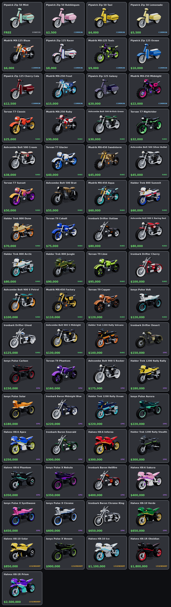
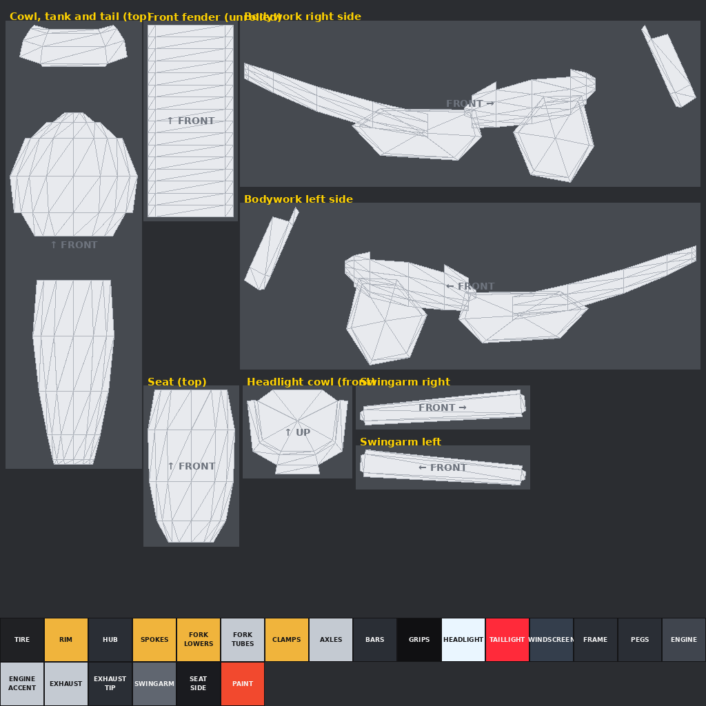

# Motorcycle Tag: bikes

Stylized low-poly motorcycles built for Roblox: a street bike (this page), a [dirt bike](dirtbike), a [superbike](superbike), a [chopper](chopper), a [scooter](scooter), an [adventure bike](adventure), an [electric bike](electric) and a [café racer](cafe). On every bike each wheel is its own mesh centred on its axle, so it can spin on its own, and the front wheel turns with the fork for steering. Every bike is **built for skins**: one 1024×1024 texture per skin. All eight share the same rig script and skin system.

## The garage: 65 bikes from 8 models

Like most Roblox motorcycle games, the shop sells many bikes that share a handful of base models, each with its own name, colourway and price. All names are made up, so rename anything you like.



| Brand | Base model | Bikes | Prices |
|---|---|---|---|
| Pipwick (Zip 50 / Zip 125) | [Scooter](scooter) | 8 | FREE to $20,000 |
| Mudrik (MX-125 / 250 / 450) | [Dirt bike](dirtbike) | 8 | $6,000 to $110,000 |
| Torvan (T7 / T9) | Street bike (this page) | 8 | $25,000 to $160,000 |
| Ironbark (Drifter / Baron) | [Chopper](chopper) | 8 | $80,000 to $650,000 |
| Halvex (HX-6 / HX-10 / HX-1R) | [Superbike](superbike) | 9 | $250,000 to $2,500,000 |
| Ashcombe (Bolt 500 / Bolt 900 S) | [Café racer](cafe) | 8 | $30,000 to $175,000 |
| Haldor (Trek 800 / Trek 1200 Rally) | [Adventure bike](adventure) | 8 | $60,000 to $300,000 |
| Ionyx (Pulse / Pulse X) | [Electric bike](electric) | 8 | $120,000 to $900,000 |

Tiers by price: Starter (free), Common, Rare (from $25,000), Epic (from $150,000) and Legendary (from $800,000). Each bike also has suggested Speed, Acceleration and Handling stats. They're set per base model, with a +1 or +2 Speed bonus on higher trims; tune or ignore them.

| File | What it is |
|---|---|
| `roblox/BikeCatalog.lua` | ModuleScript listing every bike (Id, Name, Brand, Base, Skin, Price, Tier, Stats, TextureId, ThumbnailId, and NeonColor for the electric bikes) with `Get`, `Filter` and `Spawn` helpers. The list is in price order. |
| `catalog/thumbnails/*.png` | A 512×384 shop thumbnail per bike, transparent background. |
| `catalog/catalog_sheet.png` | The overview above. |
| `catalog/catalog.json` | The same catalog as JSON. |
| `source/catalog.py` | The single source of truth: brands, names, prices and which skin each bike wears. |

### Setting it up in Roblox Studio

1. Import the eight GLBs (`MotorcycleTag_Bike`, `_DirtBike`, `_SuperBike`, `_Chopper`, `_Scooter`, `_Adventure`, `_Electric`, `_Cafe`) and put them in a folder such as `ServerStorage.Bikes`. Keep their names.
2. Bulk-import the skin PNGs from each bike's `skins/` folder and the thumbnails from `catalog/thumbnails/` (**Asset Manager → Bulk Import**). Paste each image's id into `TextureId` and `ThumbnailId` in `BikeCatalog.lua`.
3. Put `MotorcycleRig.lua` and `BikeCatalog.lua` as ModuleScripts in the same place, for example ServerStorage. Then:

   ```lua
   local BikeCatalog = require(game.ServerStorage.BikeCatalog)
   local bike = BikeCatalog.Spawn("halvex_hx6_apex", game.ServerStorage.Bikes) -- cloned, skinned and rigged
   bike.Parent = workspace
   ```

   For the shop UI, loop over `BikeCatalog.Bikes` and use `Name`, `Price`, `Tier` and `ThumbnailId` for each card.

### Adding a bike

1. Add a skin to `SKINS` in the base model's build script and run it.
2. Add a line to `BIKES` in `source/catalog.py` and run `python3 source/catalog.py`.
3. Render the thumbnails: run `npm install` once in `source/render`, then `npm run thumbnails`.
4. Run `python3 source/catalog.py --sheet` to trim the thumbnails and rebuild the overview.

## The street bike (Torvan base model)


| Steering at 30° | Wheels are separate objects |
|---|---|
|  |  |

More angles are in [`previews/`](previews).

## Files

| File | What it is |
|---|---|
| `MotorcycleTag_Bike.glb` | Main file. Use it with the Roblox 3D Importer or open it in Blender. The Classic skin is embedded. |
| `MotorcycleTag_Bike.obj` + `.mtl` | The same 15 parts as OBJ objects, for tools that prefer OBJ, using `skins/classic.png`. |
| `skin_template.png` / `uv_overlay.png` | The labelled texture layout, and a transparent wireframe to paint over. |
| `skins/*.png` | Skins: `classic` (the original coral red and gold), `nightrider`, `glacier`, `sunset`, `cobalt`, `lime`, `copper`, `phantom`. |
| `roblox/MotorcycleRig.lua` | Optional ModuleScript that welds, hinges and drives any of the bikes. |
| `source/build_motorcycle.py` | Generator for all of the above. Shared code lives in `source/shapes.py` (shapes and clearance check) and `source/skinkit.py` (skin pipeline). |

## Specs

- **Size:** 8.1 L × 4.5 H × 2.6 W studs. The seat is at 3.3 studs and the footpegs at 1.3 studs, which suits an R15 rider.
- **Axes:** +Y is up and the bike faces **−Z**, Roblox's LookVector. X points to the bike's right.
- **Budget:** 8,120 triangles across 15 meshes, with one 1024×1024 skin texture and no interior faces.
- **Shading:** edges sharper than 40° are hard and everything else is smoothed.

### Parts

| Group | Part | Pivot / notes |
|---|---|---|
| **Wheels** | `FrontWheel` | Ø 2.6 × 0.9 wide. Centred on the axle at (0, 1.3, −2.7); its bounding-box centre is the axle. |
| | `RearWheel` | Ø 2.8 × 1.16 wide. Centred on the axle at (0, 1.4, 2.7). |
| **Steering** (turns together) | `Fork`, `Handlebars`, `FrontFender`, `HeadlightCowl`, `Headlight`, `Windscreen` | Pivot is the front axle. The steering axis runs through the front wheel centre, tilted back 24° from vertical. |
| **Body** (welded) | `Frame`, `Bodywork`, `Seat`, `Engine`, `Exhaust`, `Swingarm`, `TailLight` | Pivot is the model origin, on the ground midway between the axles. `Frame` is the root. |

`Headlight` and `TailLight` are separate parts so you can set them to Neon.

### Making skins



The texture works the same way on every bike. Panels at the top are laid out as you'd see them from outside the bike, so text reads correctly, and the blocks at the bottom are solid colours for the mechanical parts.

| Panel | Notes |
|---|---|
| Bodywork right / left side | The whole side view on one canvas: cowl sides, shrouds, tank, side covers and tail. |
| Cowl, tank and tail (top) | Seen from above, with the front at the top. |
| Headlight cowl (front) | Seen from the front. |
| Front fender (unrolled), seat (top), swingarm right / left | Smaller detail areas. |

`PAINT` colours the edges and inner faces of the bodywork, so match it to your main colour. Upload the PNG and apply it with `MotorcycleRig.SetSkin(bike, "rbxassetid://<id>")`.

### Clearances

Run `python3 source/build_motorcycle.py --check` to rebuild the files, sweep the steering through ±30° and spin the wheels. It reports the tightest gaps:

- Steering parts vs the body: at least 0.10 studs at any angle. The upper fork clamp sits 0.05 above the head tube, but they share an axis like a steering bearing, so that gap never changes.
- Front tire vs fender: 0.12 studs. Rear tire vs frame and bodywork: 0.19 studs or more.
- Tire vs fork legs or swingarm: at least 0.12 studs. Only the axle stubs come closer, at about 0.06 from the hub face, and they share the wheel's axis.

## Importing into Roblox Studio

1. **Home → Import 3D**, pick `MotorcycleTag_Bike.glb`.
2. In the import settings, set the scale unit to **Stud** so 1 unit = 1 stud, and keep each mesh as a separate part. The bike should preview at about 8 studs long.
3. Import. You get a Model with 15 MeshParts named as in the table above.
4. Optional: set `CollisionFidelity` to **Hull** on both wheels. Studio only lets you change this in edit mode.

## Rigging (optional)

Copy `roblox/MotorcycleRig.lua` into a ModuleScript, for example `ServerStorage.MotorcycleRig`:

```lua
local MotorcycleRig = require(game.ServerStorage.MotorcycleRig)
local bike = game.ServerStorage.MotorcycleTag_Bike:Clone()
bike.Parent = workspace
MotorcycleRig.Rig(bike)            -- once, while the bike stands upright

MotorcycleRig.SetThrottle(bike, 1) -- -1 .. 1, drives the rear wheel
MotorcycleRig.SetSteer(bike, -0.5) -- -1 (left) .. 1 (right), servo on the raked steering axis
MotorcycleRig.SetSkin(bike, "rbxassetid://<id>") -- any uploaded skin texture
MotorcycleRig.SetHighlight(bike, Color3.fromRGB(255, 0, 0)) -- outline the player who is "it"; nil clears
```

`Rig` does the following:

- Welds the steering parts to `Fork` and every other part except the wheels to `Frame`.
- Reads the fork angle from the model name (24° here, 27° dirt bike, 23° superbike, 34° chopper, 26° scooter, 26° adventure, 24° electric, 25° café racer), a `SteeringRake` attribute, or `Rig(bike, { rake = degrees })`.
- Adds three `HingeConstraint`s, all placed on wheel centres so the rig works at any scale: a servo `SteerHinge` from Frame to Fork, a free `FrontWheelHinge` from Fork to FrontWheel, and a motorised `RearWheelHinge` from Swingarm to RearWheel.
- Adds a `KeepUpright` AlignOrientation and sets the materials (Metal, Neon lights, Glass windscreen).
- Leaves only the wheels with `CanCollide` on. Every part keeps `CanTouch` on, so `Touched` still fires for tagging.

If your game moves the bike kinematically instead, skip the module and just rotate the parts. Spin each wheel about its own X axis through its centre. To steer, rotate the six steering parts and `FrontWheel` about the raked axis through the `FrontWheel` centre.

> The rig module passes a Lua syntax check but has not been run in Studio yet. If steering or throttle turns out reversed, flip the sign in `SetSteer` or `SetThrottle`.

## Changing the design

All proportions, colours and part splits are plain numbers in `source/build_motorcycle.py`, which needs numpy and Pillow. Rerun it to regenerate the GLB, OBJ, template and skins.
