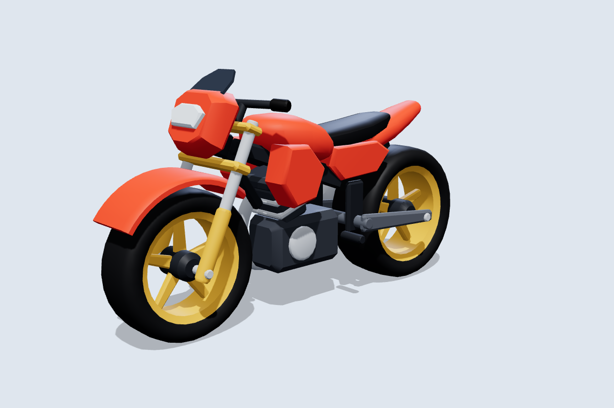
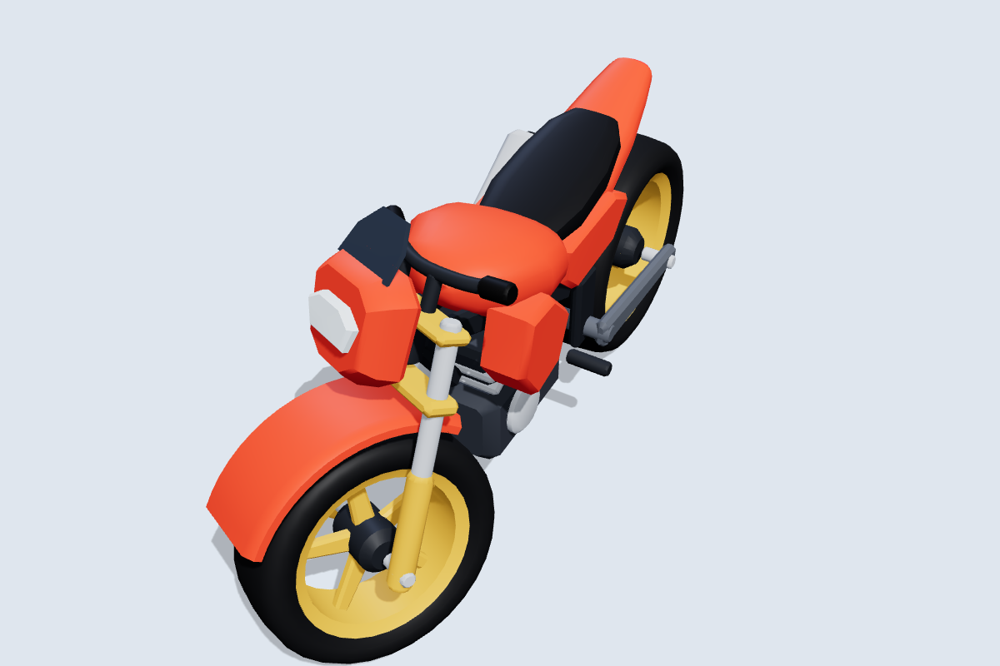
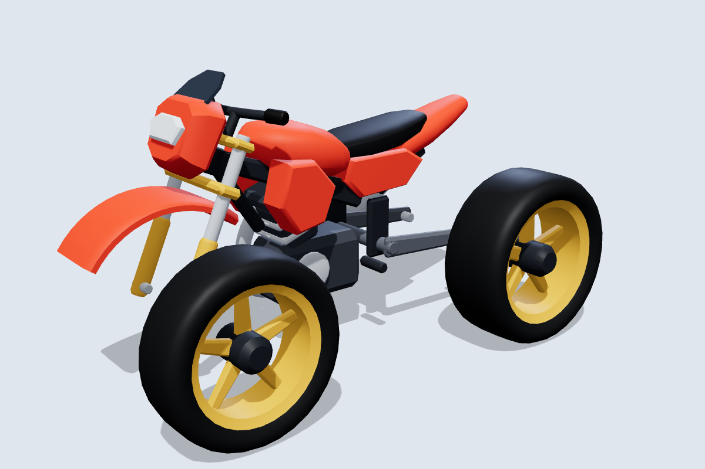

# Motorcycle Tag: bike model

A stylized low-poly motorcycle built for Roblox. Each wheel is its own mesh centred on its axle, so it can spin on its own, and the front wheel turns with the fork for steering.

More bikes, built for skins: the [dirt bike](dirtbike), [superbike](superbike), [chopper](chopper) and [scooter](scooter). All of them share the same rig script.



| Steering at 30° | Wheels are separate objects |
|---|---|
|  |  |

More angles are in [`previews/`](previews).

## Files

| File | What it is |
|---|---|
| `MotorcycleTag_Bike.glb` | Main file. Use it with the Roblox 3D Importer or open it in Blender. The palette texture is embedded. |
| `MotorcycleTag_Bike.obj` + `.mtl` + `palette.png` | The same 15 parts as OBJ objects, for tools that prefer OBJ. |
| `roblox/MotorcycleRig.lua` | Optional ModuleScript that welds, hinges and drives the imported model. |
| `source/build_motorcycle.py` | Generator for all of the above. Edit the numbers in it and rerun. |

## Specs

- **Size:** 8.1 L × 4.5 H × 2.6 W studs. The seat is at 3.3 studs and the footpegs at 1.3 studs, which suits an R15 rider.
- **Axes:** +Y is up and the bike faces **−Z**, Roblox's LookVector. X points to the bike's right.
- **Budget:** 8,120 triangles across 15 meshes, with one shared 64×64 palette texture and no interior faces.
- **Shading:** flat-colour palette. Edges sharper than 40° are hard and everything else is smoothed.

### Parts

| Group | Part | Pivot / notes |
|---|---|---|
| **Wheels** | `FrontWheel` | Ø 2.6 × 0.9 wide. Centred on the axle at (0, 1.3, −2.7); its bounding-box centre is the axle. |
| | `RearWheel` | Ø 2.8 × 1.16 wide. Centred on the axle at (0, 1.4, 2.7). |
| **Steering** (turns together) | `Fork`, `Handlebars`, `FrontFender`, `HeadlightCowl`, `Headlight`, `Windscreen` | Pivot is the front axle. The steering axis runs through the front wheel centre, tilted back 24° from vertical. |
| **Body** (welded) | `Frame`, `Bodywork`, `Seat`, `Engine`, `Exhaust`, `Swingarm`, `TailLight` | Pivot is the model origin, on the ground midway between the axles. `Frame` is the root. |

`Bodywork`, `FrontFender` and `HeadlightCowl` use only the paint colour. Remove their texture and set `Color` to recolour the bike per player, for example to mark who is "it". `Headlight` and `TailLight` are separate parts so you can set them to Neon.

### Clearances

Run `python3 source/build_motorcycle.py --check` to rebuild the files, sweep the steering through ±30° and spin the wheels. It reports the tightest gaps:

- Steering parts vs the body: at least 0.10 studs at any angle. The upper fork clamp sits 0.05 above the head tube, but they share an axis like a steering bearing, so that gap never changes.
- Front tire vs fender: 0.12 studs. Rear tire vs frame and bodywork: 0.19 studs or more.
- Tire vs fork legs or swingarm: at least 0.12 studs. Only the axle stubs come closer, at about 0.06 from the hub face, and they share the wheel's axis.

## Importing into Roblox Studio

1. **Home → Import 3D**, pick `MotorcycleTag_Bike.glb`.
2. In the import settings, set the scale unit to **Stud** so 1 unit = 1 stud, and keep each mesh as a separate part. The bike should preview at about 8 studs long.
3. Import. You get a Model with 15 MeshParts named as in the table above.
4. Optional: set `CollisionFidelity` to **Hull** on both wheels. Studio only lets you change this in edit mode.

## Rigging (optional)

Copy `roblox/MotorcycleRig.lua` into a ModuleScript, for example `ServerStorage.MotorcycleRig`:

```lua
local MotorcycleRig = require(game.ServerStorage.MotorcycleRig)
local bike = game.ServerStorage.MotorcycleTag_Bike:Clone()
bike.Parent = workspace
MotorcycleRig.Rig(bike)            -- once, while the bike stands upright

MotorcycleRig.SetThrottle(bike, 1) -- -1 .. 1, drives the rear wheel
MotorcycleRig.SetSteer(bike, -0.5) -- -1 (left) .. 1 (right), servo on the raked steering axis
MotorcycleRig.SetPaint(bike, Color3.fromRGB(40, 140, 255))
MotorcycleRig.SetHighlight(bike, Color3.fromRGB(255, 0, 0)) -- outline the player who is "it"; nil clears
```

`Rig` does the following:

- Welds the steering parts to `Fork` and every other part except the wheels to `Frame`.
- Reads the fork angle from the model name (24° here, 27° dirt bike, 23° superbike, 34° chopper, 26° scooter), a `SteeringRake` attribute, or `Rig(bike, { rake = degrees })`.
- Adds three `HingeConstraint`s, all placed on wheel centres so the rig works at any scale: a servo `SteerHinge` from Frame to Fork, a free `FrontWheelHinge` from Fork to FrontWheel, and a motorised `RearWheelHinge` from Swingarm to RearWheel.
- Adds a `KeepUpright` AlignOrientation and sets the materials (Metal, Neon lights, Glass windscreen).
- Leaves only the wheels with `CanCollide` on. Every part keeps `CanTouch` on, so `Touched` still fires for tagging.

If your game moves the bike kinematically instead, skip the module and just rotate the parts. Spin each wheel about its own X axis through its centre. To steer, rotate the six steering parts and `FrontWheel` about the raked axis through the `FrontWheel` centre.

> The rig module passes a Lua syntax check but has not been run in Studio yet. If steering or throttle turns out reversed, flip the sign in `SetSteer` or `SetThrottle`.

## Changing the design

All proportions, colours and part splits are plain numbers in `source/build_motorcycle.py`, which only needs `numpy`. Rerun it to regenerate the GLB, OBJ and palette.
