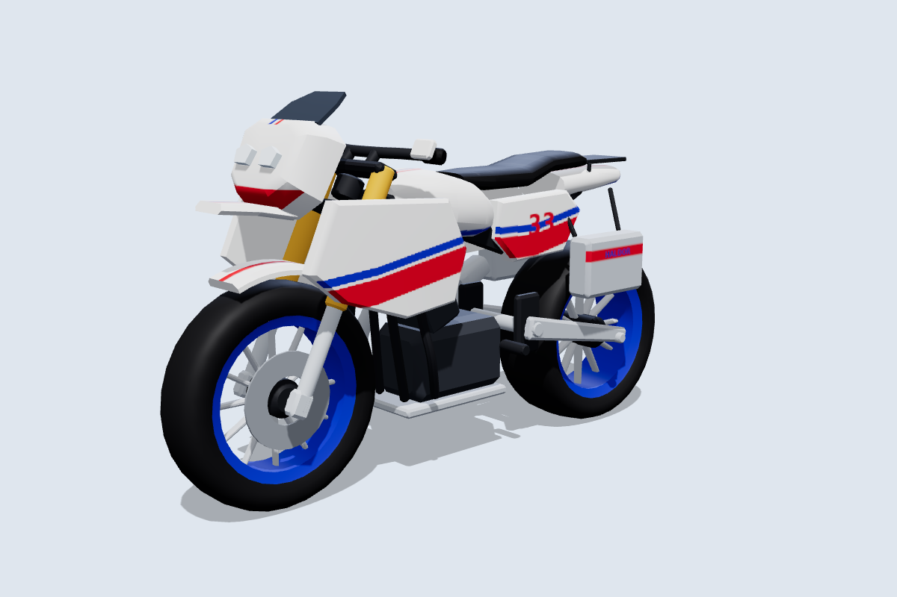
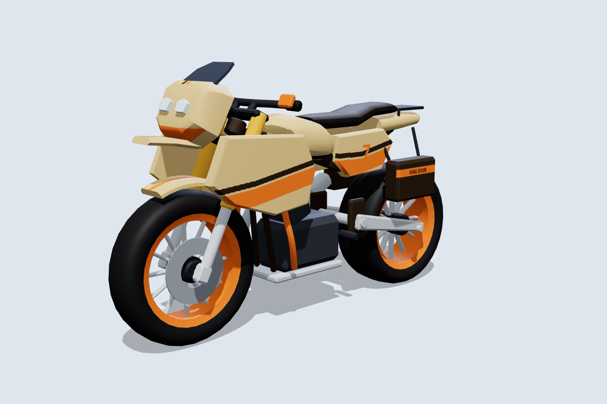
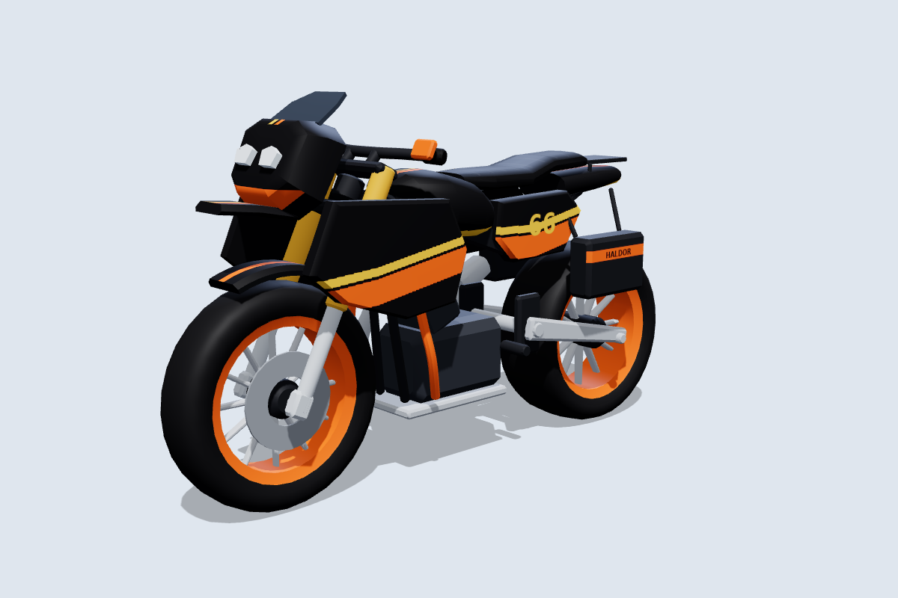
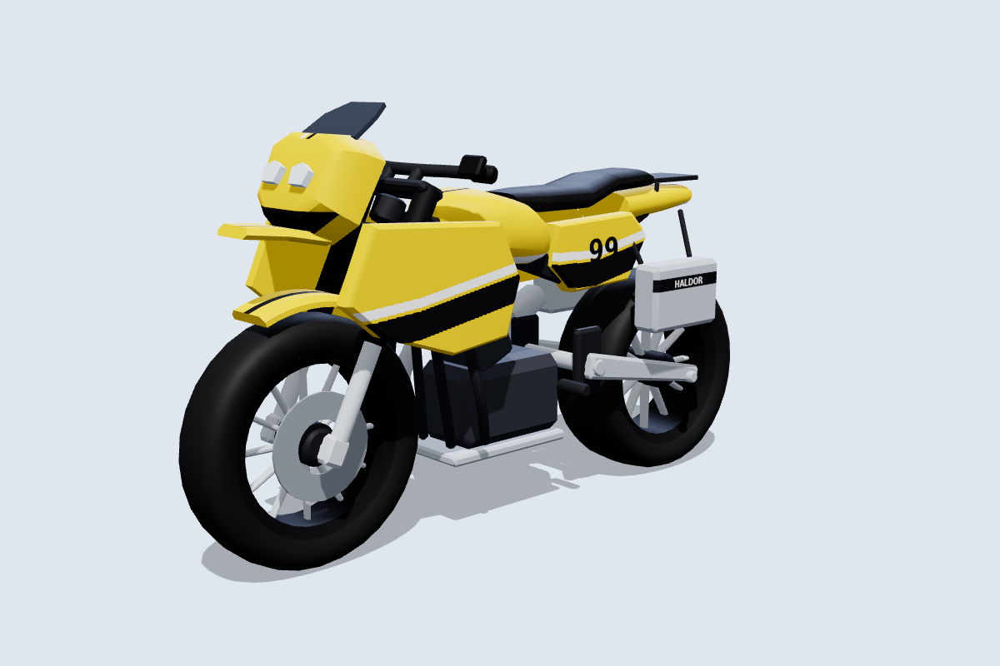
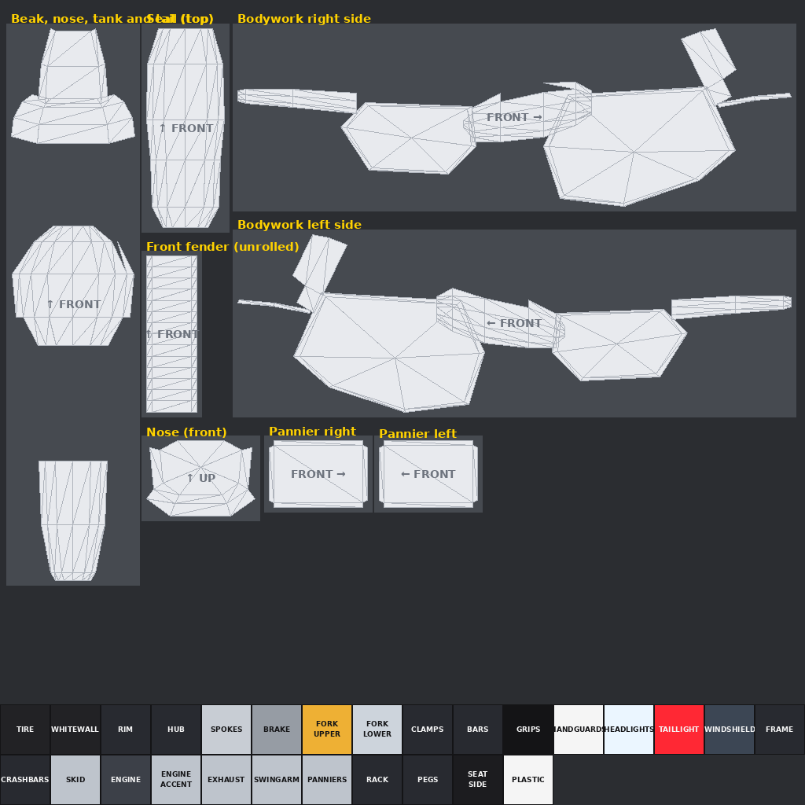

# Motorcycle Tag: adventure bike

The sixth bike: a tall, rugged adventure bike with a beak and nose fairing, a tall windshield, hand guards, crash bars, a skid plate, wire-spoked wheels, a luggage rack and aluminium panniers. It follows the same conventions as the [other bikes](../README.md) and is **built for skins**: one 1024×1024 texture per skin. In the [garage](../README.md#the-garage) it is sold as the Haldor Trek 800 and Trek 1200 Rally.

| Dune | Volcano | Rally |
|---|---|---|
|  |  |  |

More angles, including steering at 30° and the wheels pulled out, are in [`previews/`](previews).

## How it differs from the other bikes

- **Steering:** as on a real adventure bike, the nose fairing, beak, headlights and windshield are fixed to the frame. The fork, the bars with their hand guards, and the low front fender turn behind them.
- **Panniers:** `Panniers` (boxes and their rails) is its own part. A game can hide it for a stripped-down trim of the same bike.

## Files

| File | What it is |
|---|---|
| `MotorcycleTag_Adventure.glb` | Main file for the Roblox 3D Importer or Blender, with the Summit skin embedded. |
| `MotorcycleTag_Adventure.obj` + `.mtl` | The same 15 parts as OBJ objects, using `skins/summit.png`. |
| `skin_template.png` / `uv_overlay.png` | The labelled texture layout, and a transparent wireframe to paint over. |
| `skins/*.png` | Skins: `summit`, `dune`, `arctic`, `jungle`, `volcano`, `rally`, `ocean`, `stealth`. |
| `source/build_adventure.py` | Generator for all of the above. It needs numpy and Pillow, and uses the shared `../source/skinkit.py`. |

## Making skins

| Panel | Notes |
|---|---|
| Bodywork right / left side | The whole side view on one canvas: beak, nose, shrouds, tank, side covers and tail. |
| Beak, nose, tank and tail (top) | Seen from above, with the front at the top. |
| Nose (front) | Seen from the front. The headlights sit in the middle. |
| Pannier right / left | The outer face of each pannier. Good for stickers; the examples print the brand. |
| Front fender (unrolled), seat (top) | |

`PLASTIC` colours bodywork edges and undersides. `PANNIERS`, `HANDGUARDS`, `CRASHBARS` and `SKID` recolour those parts. Upload the PNG and apply it with `MotorcycleRig.SetSkin(bike, "rbxassetid://<id>")`.

## Specs

- **Size:** 8.3 L × 5.0 H × 2.3 W studs, the tallest bike. The seat is at about 3.95 studs and the footpegs at 1.55 studs.
- **Axes:** +Y is up and the bike faces **−Z**. The steering axis runs through the front wheel centre, tilted back **26°**.
- **Budget:** 10,076 triangles across 15 meshes, with one texture.

| Group | Parts | Pivot |
|---|---|---|
| **Wheels** | `FrontWheel` (Ø 2.8 × 0.72), `RearWheel` (Ø 2.72 × 1.04) | Each centred on its axle at (0, 1.4, −2.85) and (0, 1.36, 2.7). |
| **Steering** | `Fork`, `Handlebars`, `FrontFender` | Front axle. |
| **Body** (welded) | `Frame`, `Bodywork`, `Headlights`, `Windshield`, `Seat`, `Panniers`, `Engine`, `Exhaust`, `Swingarm`, `TailLight` | Model origin. `Frame` is the root. |

`python3 source/build_adventure.py --check` sweeps the steering through ±30° and spins both wheels:

- Steering parts vs the fixed fairing and body: at least 0.10 studs at any angle. The fork clamps sit 0.05 from the head tube, but they share the steering axis like a bearing, so that gap never changes.
- Front tire vs fender: 0.10 studs. Rear tire vs panniers: 0.20 studs.
- Closest of all are the axle stubs, about 0.05 studs from the hubs. They share the wheels' axis, so they don't collide.

## Importing and rigging

Import the same way as the other bikes: **Home → Import 3D**, scale unit **Stud**, keep the meshes as separate parts. `roblox/MotorcycleRig.lua` picks the 26° rake from the model name `MotorcycleTag_Adventure`.
