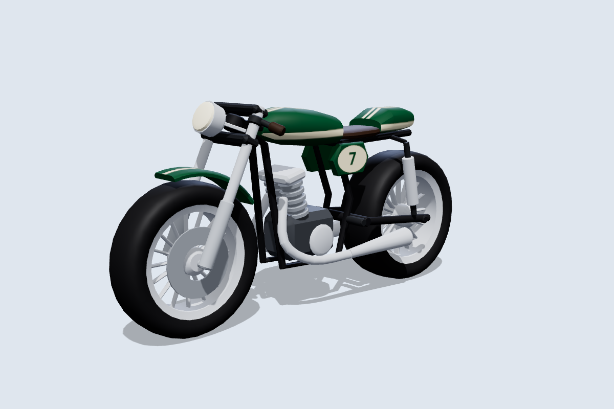
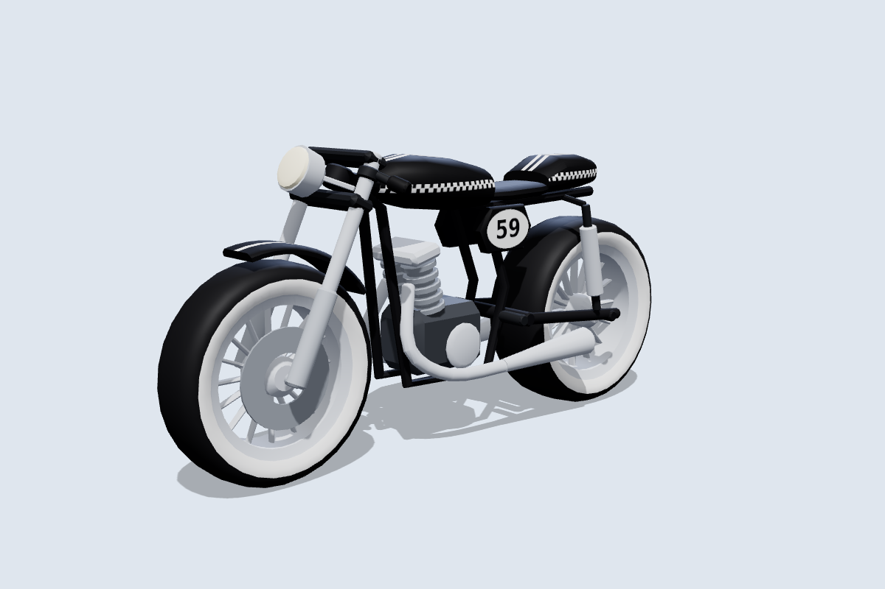
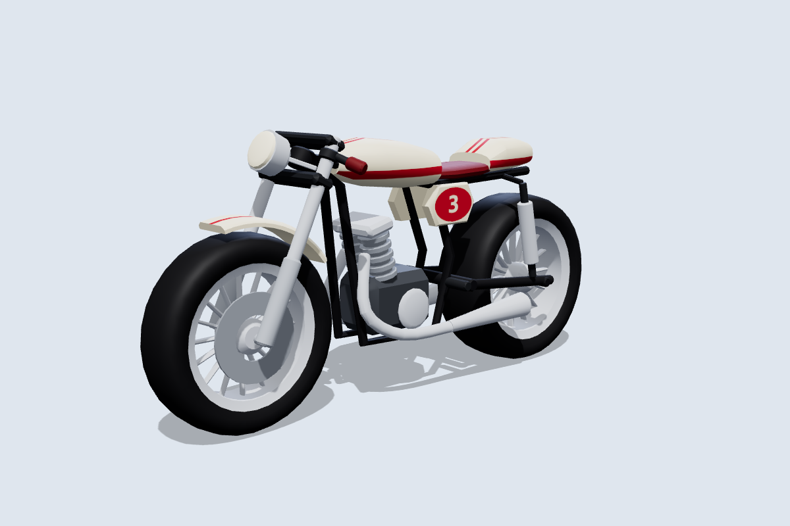
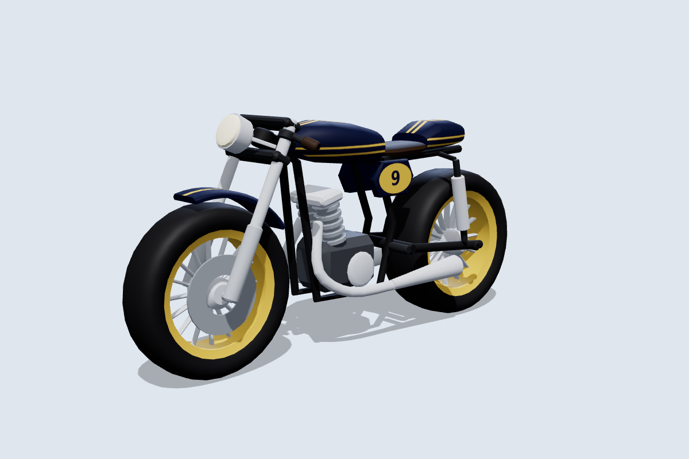
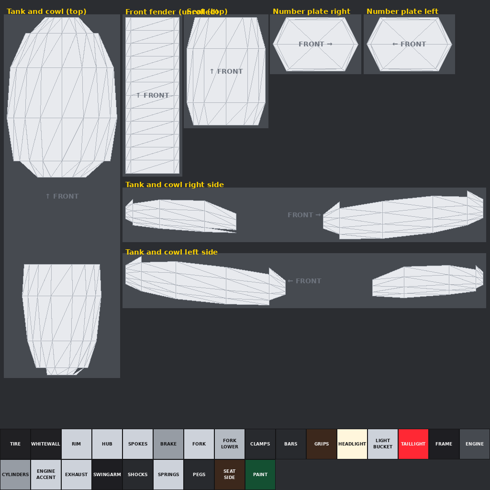

# Motorcycle Tag: café racer

The eighth bike: a retro café racer with a long tank, a humped seat cowl, clip-on bars, a round chrome headlight, a finned twin engine, twin megaphone exhausts, twin rear shocks and number roundels. It follows the same conventions as the [other bikes](../README.md) and is **built for skins**: one 1024×1024 texture per skin. In the [garage](../README.md#the-garage) it is sold as the Ashcombe Bolt 500 and Bolt 900 S.

| Rocker | Cream | Midnight |
|---|---|---|
|  |  |  |

More angles, including steering at 30° and the wheels pulled out, are in [`previews/`](previews).

## Files

| File | What it is |
|---|---|
| `MotorcycleTag_Cafe.glb` | Main file for the Roblox 3D Importer or Blender, with the British Green skin embedded. |
| `MotorcycleTag_Cafe.obj` + `.mtl` | The same 13 parts as OBJ objects, using `skins/british_green.png`. |
| `skin_template.png` / `uv_overlay.png` | The labelled texture layout, and a transparent wireframe to paint over. |
| `skins/*.png` | Skins: `british_green`, `cream`, `silver_bullet`, `brat`, `racing_red`, `petrol`, `midnight`, `rocker`. |
| `source/build_cafe.py` | Generator for all of the above. It needs numpy and Pillow, and uses the shared `../source/skinkit.py`. |

## Making skins

| Panel | Notes |
|---|---|
| Tank and cowl right / left side | One side-view canvas covering the tank and the seat cowl, so a racing stripe can run along both. |
| Tank and cowl (top) | Seen from above, with the front at the top. |
| Number plate right / left | The side covers. The examples paint a number roundel here. |
| Front fender (unrolled), seat (top) | |

`PAINT` colours panel edges and undersides. `WHITEWALL` gives the tires white walls, as in the Rocker skin. Upload the PNG and apply it with `MotorcycleRig.SetSkin(bike, "rbxassetid://<id>")`.

## Specs

- **Size:** 8.0 L × 3.9 H × 2.1 W studs. The seat is low at about 3.3 studs, and the rear-set footpegs are at 1.6 studs.
- **Axes:** +Y is up and the bike faces **−Z**. The steering axis runs through the front wheel centre, tilted back **25°**.
- **Budget:** 10,116 triangles across 13 meshes, with one texture.

| Group | Parts | Pivot |
|---|---|---|
| **Wheels** | `FrontWheel` (Ø 2.64 × 0.76), `RearWheel` (Ø 2.72 × 1.0) | Each centred on its axle at (0, 1.32, −2.7) and (0, 1.36, 2.6). |
| **Steering** | `Fork` (with the headlight bucket), `Handlebars`, `FrontFender`, `Headlight` | Front axle. |
| **Body** (welded) | `Frame`, `Bodywork`, `Seat`, `Engine`, `Exhaust`, `Swingarm`, `TailLight` | Model origin. `Frame` is the root. |

`python3 source/build_cafe.py --check` sweeps the steering through ±30° and spins both wheels:

- Steering parts vs the body: at least 0.12 studs at any angle. The fork clamps pass 0.05 from the frame tubes where those join the head tube.
- Front tire vs fender: 0.10 studs. Rear tire vs the megaphones: 0.10 studs.
- Closest of all are the axle stubs, about 0.05 studs from the hubs. They share the wheels' axis, so they don't collide.

## Importing and rigging

Import the same way as the other bikes: **Home → Import 3D**, scale unit **Stud**, keep the meshes as separate parts. `roblox/MotorcycleRig.lua` picks the 25° rake from the model name `MotorcycleTag_Cafe`.
