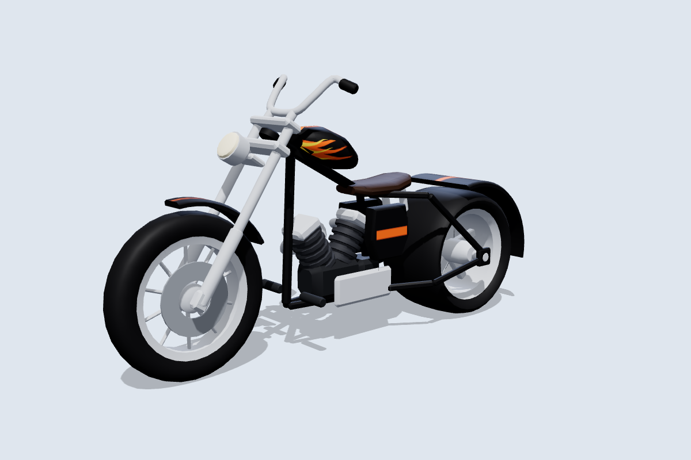
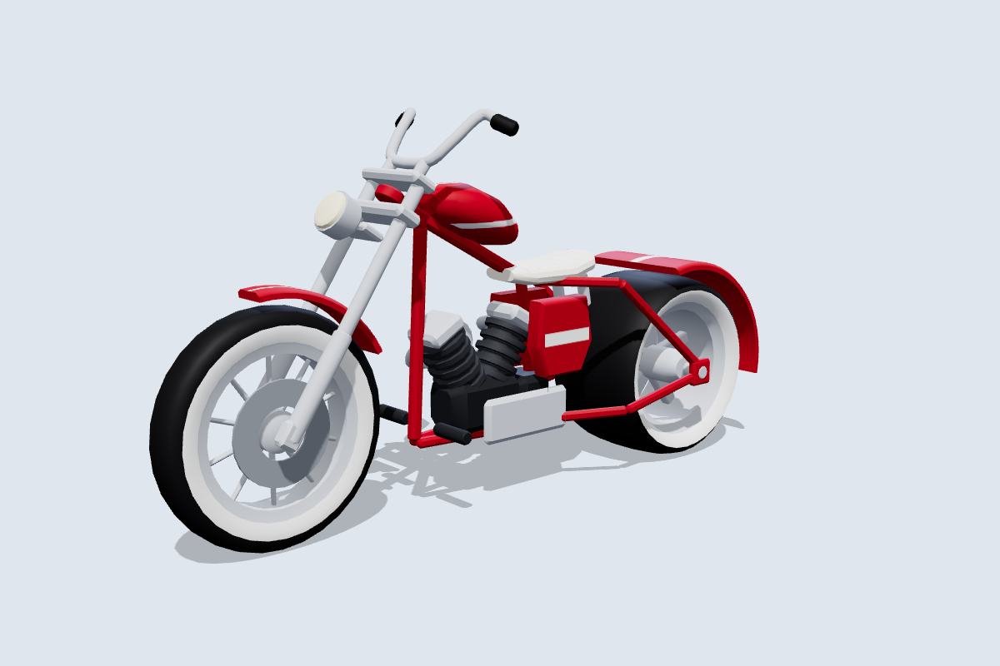
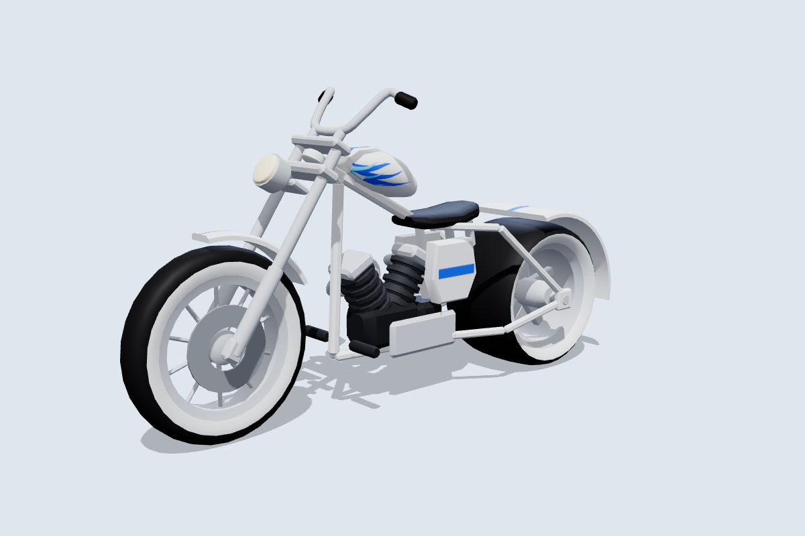
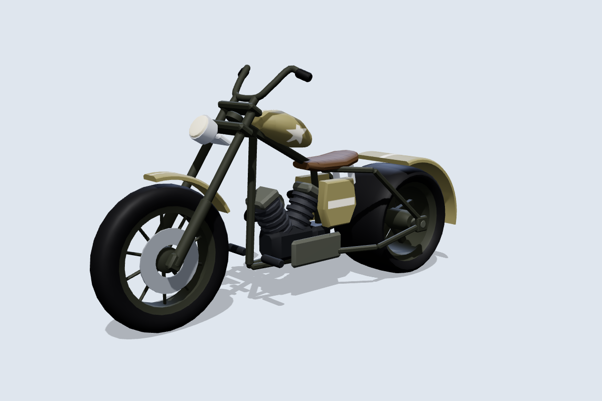
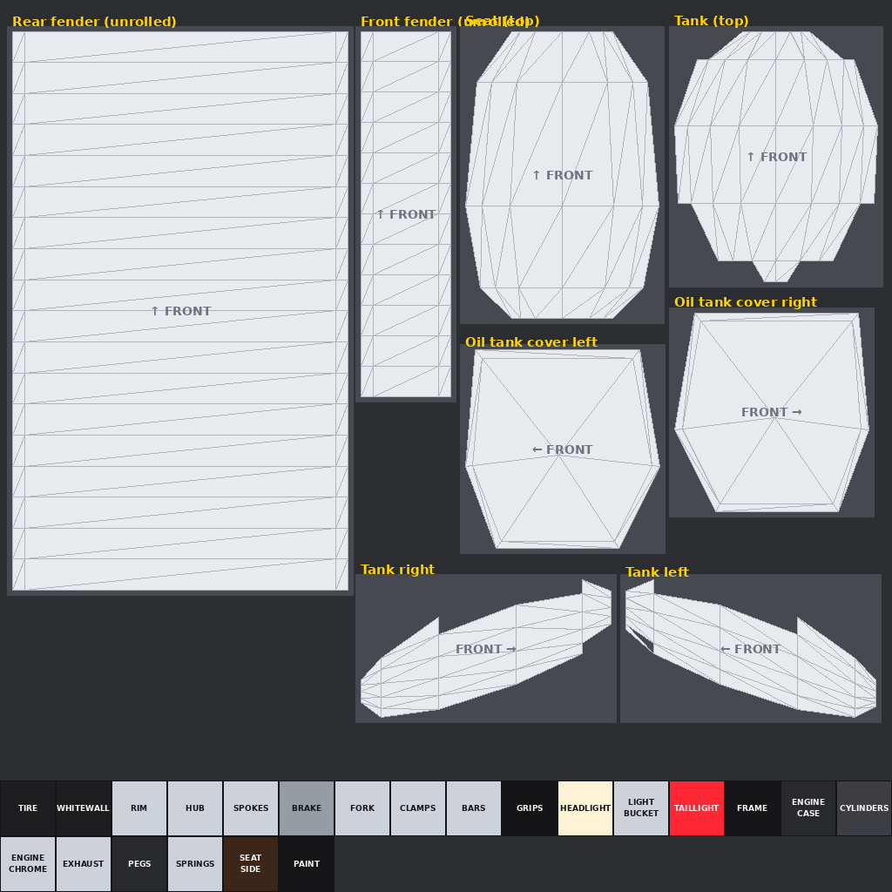

# Motorcycle Tag: chopper

The fourth bike: a long, low chopper with a 34° raked-out fork, ape-hanger bars, a teardrop tank, a V-twin engine with finned cylinders, a fat rear tire with a deep fender, and twin drag pipes. It follows the same conventions as the [other bikes](../README.md) and is **built for skins**: one 1024×1024 texture per skin.

| Cherry | Ghost | Desert |
|---|---|---|
|  |  |  |

More angles, including steering at 30° and the wheels pulled out, are in [`previews/`](previews).

## Files

| File | What it is |
|---|---|
| `MotorcycleTag_Chopper.glb` | Main file for the Roblox 3D Importer or Blender, with the Outlaw skin embedded. |
| `MotorcycleTag_Chopper.obj` + `.mtl` | The same 13 parts as OBJ objects, using `skins/outlaw.png`. |
| `skin_template.png` / `uv_overlay.png` | The labelled texture layout, and a transparent wireframe to paint over. |
| `skins/*.png` | Skins: `outlaw` (black, orange flames), `cherry` (candy red, whitewalls), `ghost` (white, blue flames), `desert` (olive with a star), `midnight_blue`, `emerald`, `hellfire`, `chrome_king`. |
| `source/build_chopper.py` | Generator for all of the above. It needs numpy and Pillow, and uses the shared `../source/skinkit.py`. |

## Making skins

Panels at the top of the texture are laid out as you'd see them from outside the bike, so text and flames read correctly:

| Panel | Notes |
|---|---|
| Tank right / left | The main graphics area. Flames lick back from the front edge. |
| Tank (top) | Seen from above, with the front at the top. |
| Oil tank cover right / left | Small side panels under the seat. |
| Rear fender, front fender (unrolled) | Each fender laid flat along its curve, with the front at the top. |
| Seat (top) | |

The blocks at the bottom are solid colours for everything else. `PAINT` colours fender edges and undersides, `FRAME` the whole frame, and `WHITEWALL` the lower tire sidewalls: set it to white for whitewall tires or match `TIRE` to hide them. Upload the PNG and apply it with `MotorcycleRig.SetSkin(bike, "rbxassetid://<id>")`.

## Specs

- **Size:** 8.95 L × 4.8 H × 2.3 W studs, the longest bike. The seat is low at about 2.85 studs, and the footpegs are forward-mounted at 1.05 studs.
- **Axes:** +Y is up and the bike faces **−Z**. The steering axis runs through the front wheel centre, tilted back **34°**.
- **Budget:** 10,364 triangles across 13 meshes, with one texture.

| Group | Parts | Pivot |
|---|---|---|
| **Wheels** | `FrontWheel` (Ø 2.72 × 0.52, tall and skinny), `RearWheel` (Ø 2.5 × 1.5, fat) | Each centred on its axle at (0, 1.36, −3.3) and (0, 1.25, 2.75). |
| **Steering** | `Fork`, `Handlebars`, `FrontFender`, `Headlight` | Front axle. |
| **Body** (welded) | `Frame`, `Bodywork`, `Seat`, `Engine`, `Exhaust`, `Swingarm`, `TailLight` | Model origin. `Frame` is the root. |

The frame is a rigid hardtail, so `Swingarm` is the rear frame stays. That name lets the rig find the rear axle.

`python3 source/build_chopper.py --check` sweeps the steering through ±30° and spins both wheels:

- Steering parts vs the body: about 0.15 studs or more at any angle. The fork clamps sit 0.05 from the head tube, but they share the steering axis like a bearing, so that gap never changes.
- Front tire vs fender: 0.10 studs.
- Rear tire vs fender: 0.12 studs.
- Closest of all are the axle stubs, about 0.05 studs from the hubs. They share the wheels' axis, so they don't collide.

## Importing and rigging

Import the same way as the other bikes: **Home → Import 3D**, scale unit **Stud**, keep the meshes as separate parts. `roblox/MotorcycleRig.lua` picks the 34° rake from the model name `MotorcycleTag_Chopper`. If you rename the model, give it a `SteeringRake` attribute of 34 or call `Rig(bike, { rake = 34 })`.
