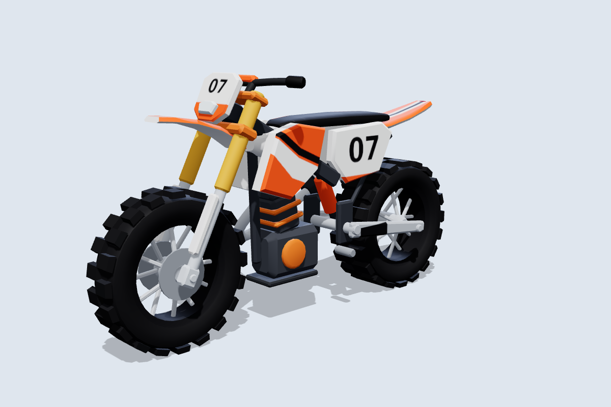
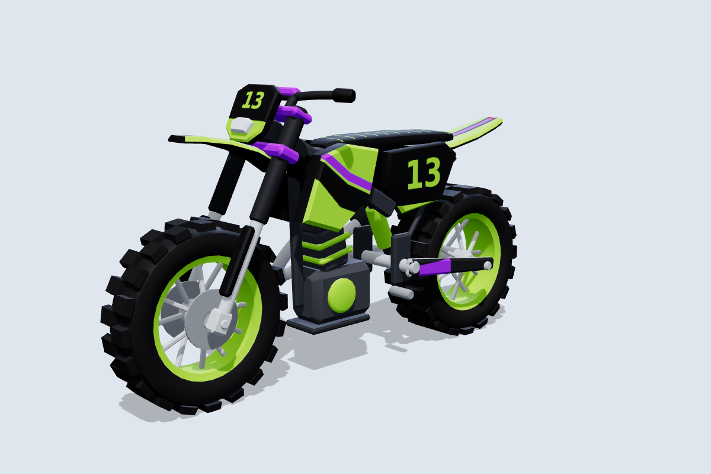
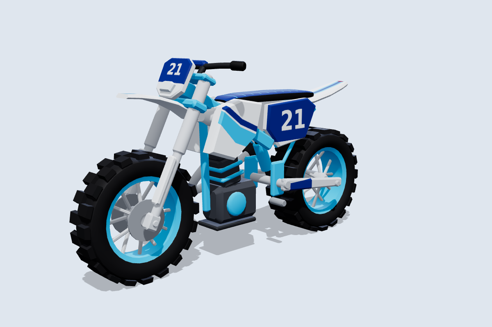
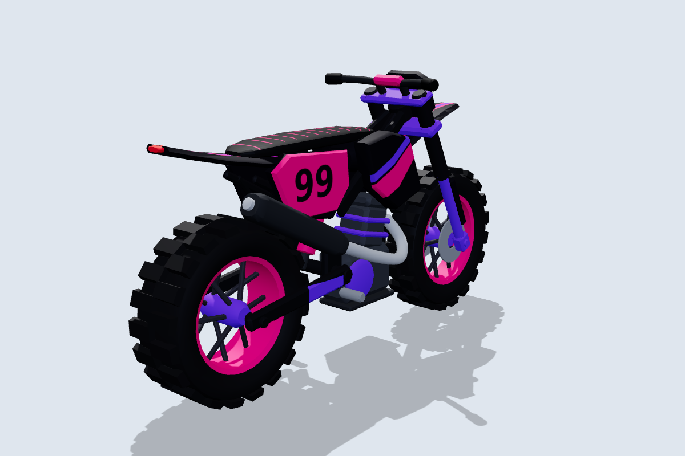
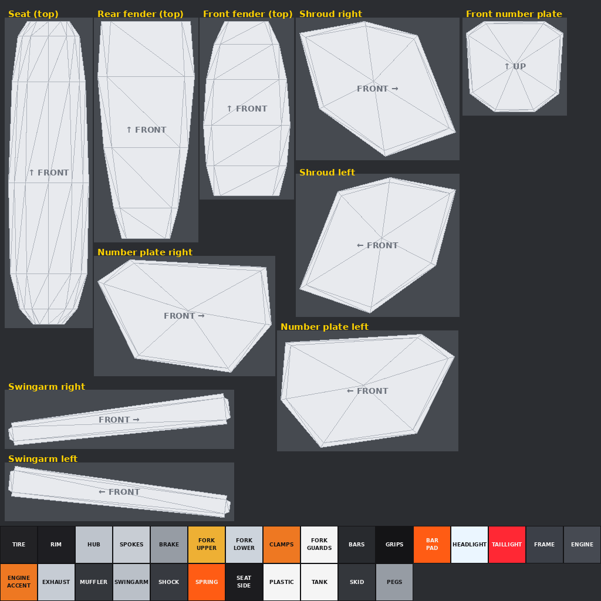

# Motorcycle Tag: dirt bike

The second bike: a tall, skinny motocross bike with knobby tires, a high front fender and big number plates. It follows the same conventions as the [street bike](../README.md): separate wheel meshes centred on their axles, the same part names, and the same rig script. Unlike the street bike, it is **built for skins**: the whole bike uses one 1024×1024 texture, so a new skin is just a new image.

| Toxic | Frost | Midnight |
|---|---|---|
|  |  |  |

More angles, including steering at 30° and the wheels pulled out, are in [`previews/`](previews).

## Files

| File | What it is |
|---|---|
| `MotorcycleTag_DirtBike.glb` | Main file for the Roblox 3D Importer or Blender, with the Blaze skin embedded. |
| `MotorcycleTag_DirtBike.obj` + `.mtl` | The same 14 parts as OBJ objects, using `skins/blaze.png`. |
| `skin_template.png` | The texture layout with every paintable area labelled. Start new skins from this. |
| `uv_overlay.png` | Transparent wireframe of the layout. Put it on a top layer while you paint and hide it before export. |
| `skins/*.png` | Example skins: `blaze`, `toxic`, `frost`, `midnight`. |
| `source/build_dirtbike.py` | Generator for all of the above. It needs numpy and Pillow, and reuses the street bike's shape code. |

## Making skins

The texture has two zones.

**Panels (top).** Each plastic panel is laid out flat, as you'd see it standing next to the bike, so anything you paint upright appears upright on the model. Numbers and text read correctly, and nothing is mirrored. The arrows show where the bike's front is.

| Panel | Notes |
|---|---|
| Shroud right / left | The big side panels by the tank. Good spots for main graphics. |
| Number plate right / left | Side plates under the seat. On the right side, the muffler covers part of the lower plate. |
| Front number plate | Seen from the front. The headlight covers the bottom third. |
| Front fender, rear fender, seat | Seen from above, with the front at the top. |
| Swingarm right / left | Long, thin sticker areas. |

**Blocks (bottom two rows).** Each mechanical part (tire, rims, fork, frame, engine and so on) samples the centre of its 64×64 block, so it shows as one solid colour. Fill a block to recolour that part. `PLASTIC` colours the edges and inner faces of every panel, so match it to your main body colour.

Workflow:

1. Open `skin_template.png` (or an existing skin) in any image editor and add `uv_overlay.png` as a top layer.
2. Paint the panels and fill the blocks, letting colour run a few pixels past each panel outline.
3. Hide the overlay, export a 1024×1024 PNG and upload it to Roblox.
4. Apply it with `MotorcycleRig.SetSkin(bike, "rbxassetid://<id>")`. In Studio you can also paste the ID into `TextureID` on every part except the lights.

To generate skins in code, add an entry to `SKINS` in `source/build_dirtbike.py` and rerun the script.

## Specs

- **Size:** 8.2 L × 4.6 H × 2.4 W studs, close to the street bike so neither is easier to tag. The seat is at about 3.8 studs and the footpegs at 1.2 studs.
- **Axes:** +Y is up and the bike faces **−Z**. The steering axis runs through the front wheel centre, tilted back **27°**.
- **Budget:** 10,568 triangles across 14 meshes, about half of them in the knobby tires, with one texture.

| Group | Parts | Pivot |
|---|---|---|
| **Wheels** | `FrontWheel` (Ø 2.76 × 0.68), `RearWheel` (Ø 2.72 × 1.0) | Each centred on its axle at (0, 1.38, −2.85) and (0, 1.36, 2.65). Even knob counts keep the bounding-box centre on the axle. |
| **Steering** | `Fork`, `Handlebars`, `FrontFender`, `FrontPlate`, `Headlight` | Front axle. |
| **Body** (welded) | `Frame`, `Bodywork`, `Seat`, `Engine`, `Exhaust`, `Swingarm`, `TailLight` | Model origin. `Frame` is the root. |

`python3 source/build_dirtbike.py --check` sweeps the steering through ±30° and spins both wheels:

- Steering parts vs the body: at least 0.11 studs at any angle. The upper fork clamp sits 0.05 above the head tube, but they share the steering axis like a bearing, so that gap never changes.
- Front tire vs fender: 0.97 studs, the high-fender look.
- Rear tire: 0.11 studs to the muffler and at least 0.19 to the bodywork.
- Closest of all are the axle stubs, 0.07 to 0.08 studs from the hubs. They share the wheels' axis, so they don't collide.

## Importing and rigging

Import the same way as the street bike: **Home → Import 3D**, scale unit **Stud**, keep the meshes as separate parts. `roblox/MotorcycleRig.lua` handles both bikes and picks the 27° rake from the model name `MotorcycleTag_DirtBike`. If you rename the model, give it a `SteeringRake` attribute of 27 or call `Rig(bike, { rake = 27 })`.
