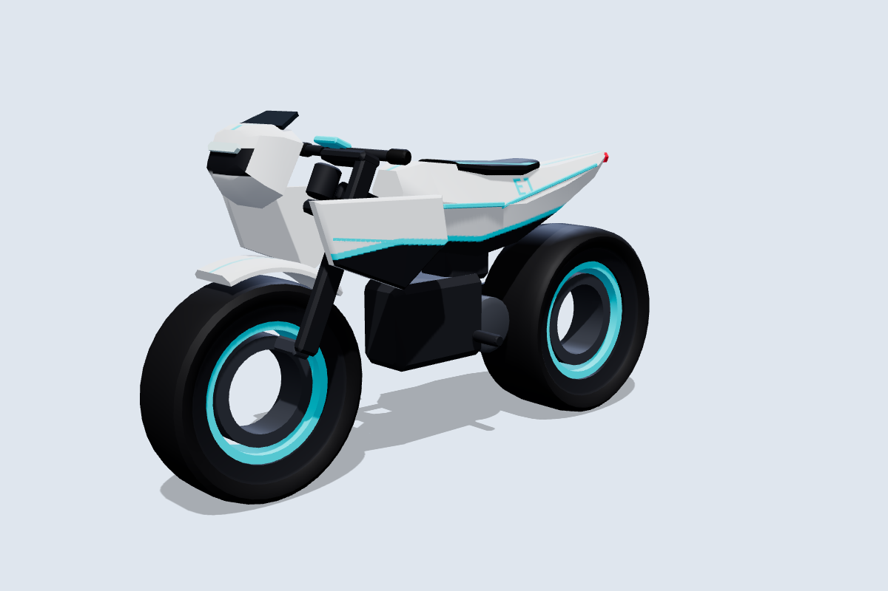
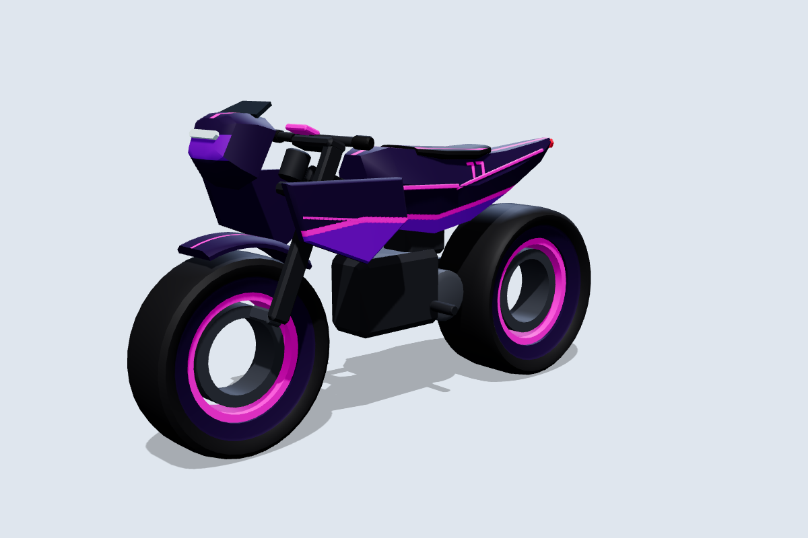
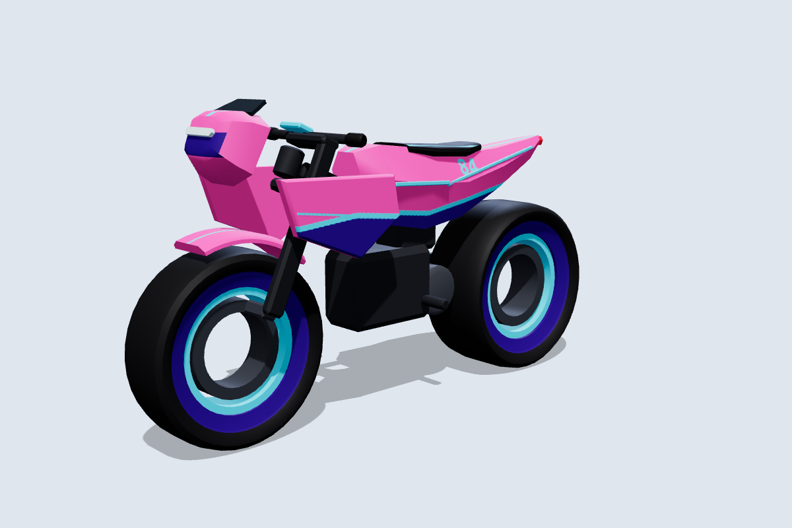
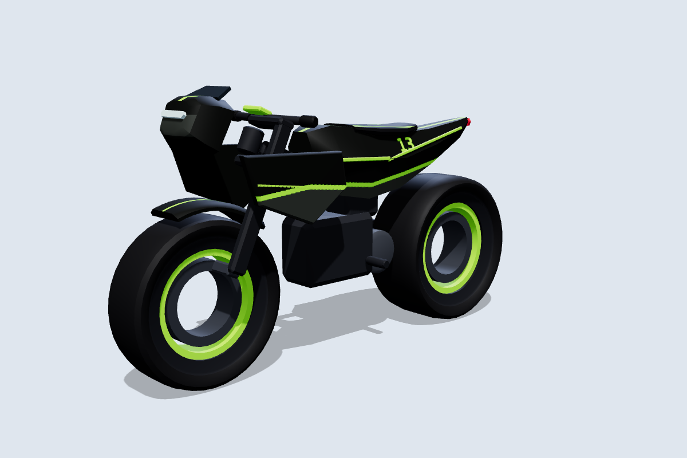
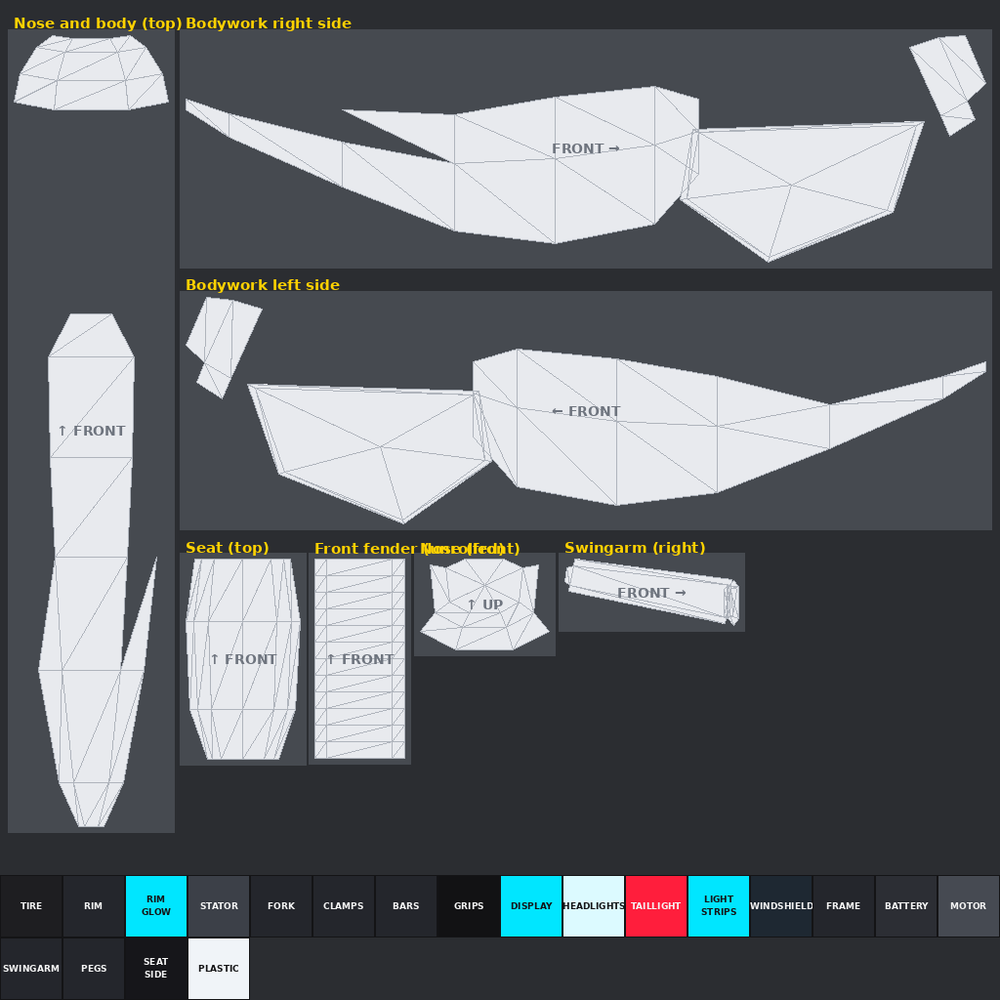

# Motorcycle Tag: electric bike

The seventh bike: a futuristic electric bike with sharp angular bodywork, a single-sided fork and swingarm, glowing light strips and **hubless wheels**. It follows the same conventions as the [other bikes](../README.md) and is **built for skins**: one 1024×1024 texture per skin. In the [garage](../README.md#the-garage) it is sold as the Ionyx Pulse and Pulse X.

| Nebula | Synthwave | Venom |
|---|---|---|
|  |  |  |

More angles, including steering at 30° and the wheels pulled out, are in [`previews/`](previews).

## How it differs from the other bikes

- **Hubless wheels:** each wheel is a tire, a rim and a glow ring with an open centre, still one mesh centred on its axle. A fixed stator ring sits inside the opening, part of `Fork` at the front and `Swingarm` at the back, so the wheel spins around it with a 0.06–0.08 stud gap.
- **Single-sided:** the fork arm is on the left and the swingarm on the right, so one side of each wheel is completely open.
- **Fixed front:** the nose cowl, light bar (`Headlights`) and visor (`Windshield`) are fixed to the frame like the superbike's. The fork, bars and blade fender turn behind them.
- **Glow:** `LightStrips` is its own part. `BikeCatalog.Spawn` turns it Neon in each catalog bike's `NeonColor`. Without the catalog it shows the skin's `LIGHT_STRIPS` colour.

## Files

| File | What it is |
|---|---|
| `MotorcycleTag_Electric.glb` | Main file for the Roblox 3D Importer or Blender, with the Volt skin embedded. |
| `MotorcycleTag_Electric.obj` + `.mtl` | The same 14 parts as OBJ objects, using `skins/volt.png`. |
| `skin_template.png` / `uv_overlay.png` | The labelled texture layout, and a transparent wireframe to paint over. |
| `skins/*.png` | Skins: `volt`, `carbon`, `solar`, `aurora`, `nebula`, `synthwave`, `chrome`, `venom`. |
| `source/build_electric.py` | Generator for all of the above. It needs numpy and Pillow, and uses the shared `../source/skinkit.py`. |

## Making skins

| Panel | Notes |
|---|---|
| Bodywork right / left side | The whole side view on one canvas: nose, side blades and body shell. |
| Nose and body (top) | Seen from above, with the front at the top. |
| Nose (front) | Seen from the front. The light bar sits across the middle. |
| Front fender (unrolled), seat (top), swingarm (right) | |

`RIM_GLOW` colours the ring inside each wheel, and `LIGHT_STRIPS` and `DISPLAY` the light strips and dashboard. Match them to the glow colour. Upload the PNG and apply it with `MotorcycleRig.SetSkin(bike, "rbxassetid://<id>")`.

## Specs

- **Size:** 8.1 L × 4.45 H × 2.1 W studs. The seat is at about 3.7 studs.
- **Axes:** +Y is up and the bike faces **−Z**. The steering axis runs through the front wheel centre, tilted back **24°**.
- **Budget:** 6,044 triangles across 14 meshes, with one texture.

| Group | Parts | Pivot |
|---|---|---|
| **Wheels** | `FrontWheel` (Ø 2.6 × 0.84), `RearWheel` (Ø 2.72 × 1.16) | Each centred on its axle at (0, 1.3, −2.75) and (0, 1.36, 2.65). |
| **Steering** | `Fork`, `Handlebars`, `FrontFender` | Front axle. |
| **Body** (welded) | `Frame`, `Bodywork`, `LightStrips`, `Headlights`, `Windshield`, `Seat`, `Motor`, `Swingarm`, `TailLight` | Model origin. `Frame` is the root. |

`python3 source/build_electric.py --check` sweeps the steering through ±30° and spins both wheels:

- Steering parts vs the body: at least 0.09 studs at any angle. The fork clamps sit 0.05 from the head tube, but they share the steering axis like a bearing, so that gap never changes.
- Wheels vs their stator rings: 0.06 studs at the front and 0.08 at the back. Front tire vs fender: 0.10 studs. Rear tire vs motor: 0.12 studs.

## Importing and rigging

Import the same way as the other bikes: **Home → Import 3D**, scale unit **Stud**, keep the meshes as separate parts. `roblox/MotorcycleRig.lua` picks the 24° rake from the model name `MotorcycleTag_Electric`.
