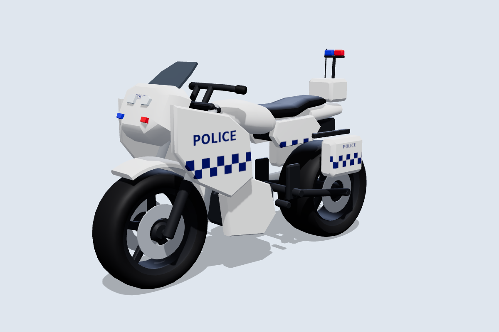
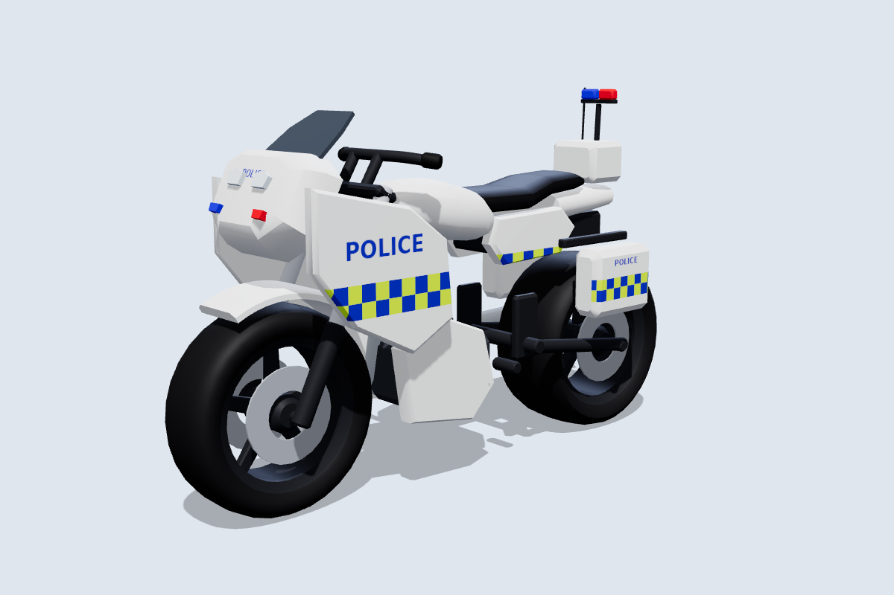
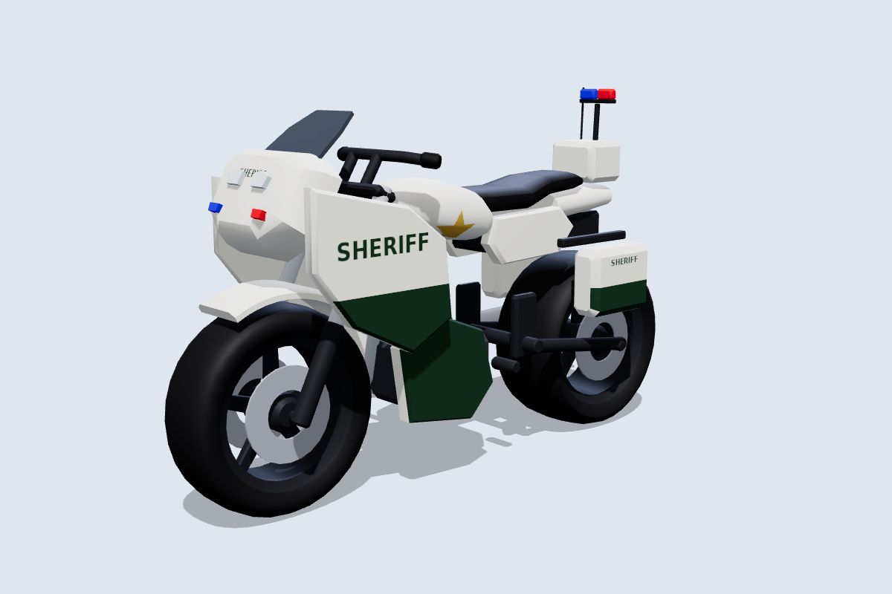
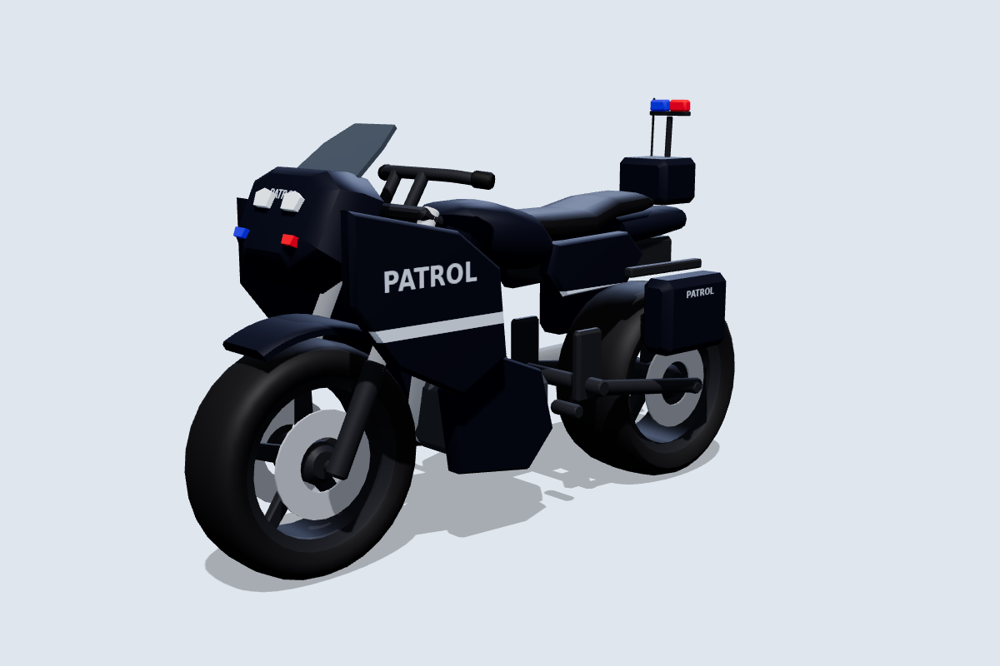
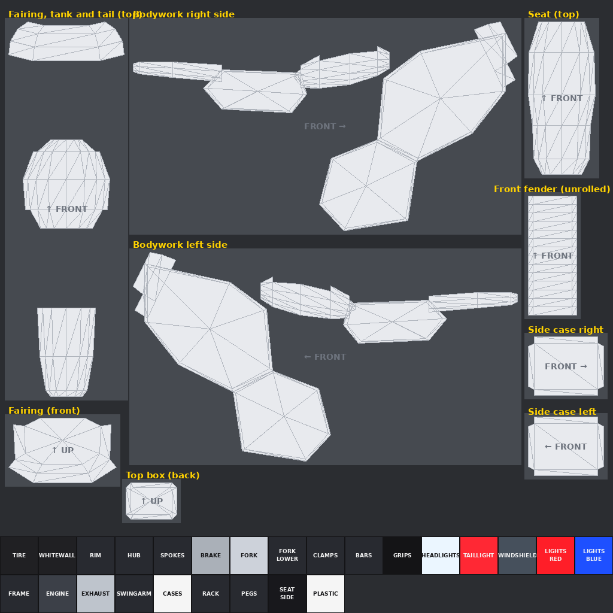

# Motorcycle Tag: police bike

The ninth bike: a big touring patrol bike with a wide fairing, twin headlights, a tall windshield, hard side cases, a top box with a light bar and radio antenna, and red and blue strobes in the nose and on the cases. It follows the same conventions as the [other bikes](../README.md) and is **built for skins**: one 1024×1024 texture per skin. In the [garage](../README.md#the-garage) it is sold as the Vigil Patrol 1000 and Pursuit 1300.



| Battenburg | Sheriff | Interceptor |
|---|---|---|
|  |  |  |

More angles, including steering at 30° and the wheels pulled out, are in [`previews/`](previews).

All markings are generic: POLICE, SHERIFF, PATROL, RANGER and TACTICAL lettering, a plain star, and checkered bands. There are no real agency names, crests or phone numbers, so it stays a game asset rather than a copy of any real force's livery.

## How it differs from the other bikes

- **Emergency lights:** the red lights are one part, `LightsRed` (left strobes, left half of the light bar, left case), and the blue lights are another, `LightsBlue`. `MotorcycleRig.Rig` colours them and leaves them unlit. `MotorcycleRig.SetSirens(bike, true)` flashes them alternately and `SetSirens(bike, false)` turns them off. Catalog police bikes have `HasSirens = true`.
- **Fixed front:** the fairing, headlights and windshield are fixed to the frame like the superbike's. The fork, bars and fender turn behind them.
- **Cases:** `Panniers` holds the side cases, top box, light bar pole and antenna, so a game can strip them off.

## Files

| File | What it is |
|---|---|
| `MotorcycleTag_Police.glb` | Main file for the Roblox 3D Importer or Blender, with the Highway skin embedded. |
| `MotorcycleTag_Police.obj` + `.mtl` | The same 17 parts as OBJ objects, using `skins/highway.png`. |
| `skin_template.png` / `uv_overlay.png` | The labelled texture layout, and a transparent wireframe to paint over. |
| `skins/*.png` | Skins: `highway`, `metro`, `sheriff`, `ranger`, `battenburg`, `interceptor`, `tactical`, `unmarked`. |
| `source/build_police.py` | Generator for all of the above. It needs numpy and Pillow, and uses the shared `../source/skinkit.py`. |

## Making skins



| Panel | Notes |
|---|---|
| Bodywork right / left side | The whole side view on one canvas: fairing, lower fairing, tank, side covers and tail. Checkered bands and lettering go here. |
| Fairing, tank and tail (top) | Seen from above, with the front at the top. |
| Fairing (front) | Seen from the front. The headlights and strobes sit in the middle. |
| Side case right / left | The outer face of each case. |
| Top box (back) | Seen from behind. Good for big lettering. |
| Front fender (unrolled), seat (top) | |

`CASES` colours the case edges, and `LIGHTS_RED` and `LIGHTS_BLUE` colour the lights. The Unmarked skin darkens them so the lights hide until the sirens come on. Upload the PNG and apply it with `MotorcycleRig.SetSkin(bike, "rbxassetid://<id>")`.

## Specs

- **Size:** 8.2 L × 5.1 H (to the light bar) × 2.4 W studs. The seat is at about 3.75 studs and the footpegs at 1.4 studs.
- **Axes:** +Y is up and the bike faces **−Z**. The steering axis runs through the front wheel centre, tilted back **26°**.
- **Budget:** 8,424 triangles across 17 meshes, with one texture.

| Group | Parts | Pivot |
|---|---|---|
| **Wheels** | `FrontWheel` (Ø 2.6 × 0.88), `RearWheel` (Ø 2.64 × 1.2) | Each centred on its axle at (0, 1.3, −2.85) and (0, 1.32, 2.75). |
| **Steering** | `Fork`, `Handlebars`, `FrontFender` | Front axle. |
| **Body** (welded) | `Frame`, `Bodywork`, `Headlights`, `Windshield`, `Seat`, `Panniers`, `LightsRed`, `LightsBlue`, `Engine`, `Exhaust`, `Swingarm`, `TailLight` | Model origin. `Frame` is the root. |

`python3 source/build_police.py --check` sweeps the steering through ±30° and spins both wheels:

- Steering parts vs the fixed fairing and body: at least 0.13 studs at any angle. The fork clamps sit 0.05 from the head tube, but they share the steering axis like a bearing, so that gap never changes.
- Front tire vs fender: 0.10 studs. Rear tire vs side cases: 0.11 studs.
- Closest of all are the axle stubs, about 0.05 studs from the hubs. They share the wheels' axis, so they don't collide.

## Importing and rigging

Import the same way as the other bikes: **Home → Import 3D**, scale unit **Stud**, keep the meshes as separate parts. `roblox/MotorcycleRig.lua` picks the 26° rake from the model name `MotorcycleTag_Police`.

```lua
MotorcycleRig.Rig(bike)
bike.Parent = workspace
MotorcycleRig.SetSirens(bike, true)  -- lights flash until SetSirens(bike, false)
```
