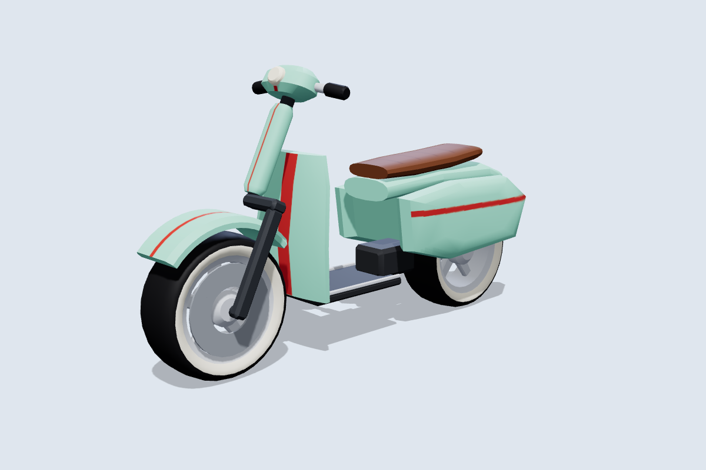
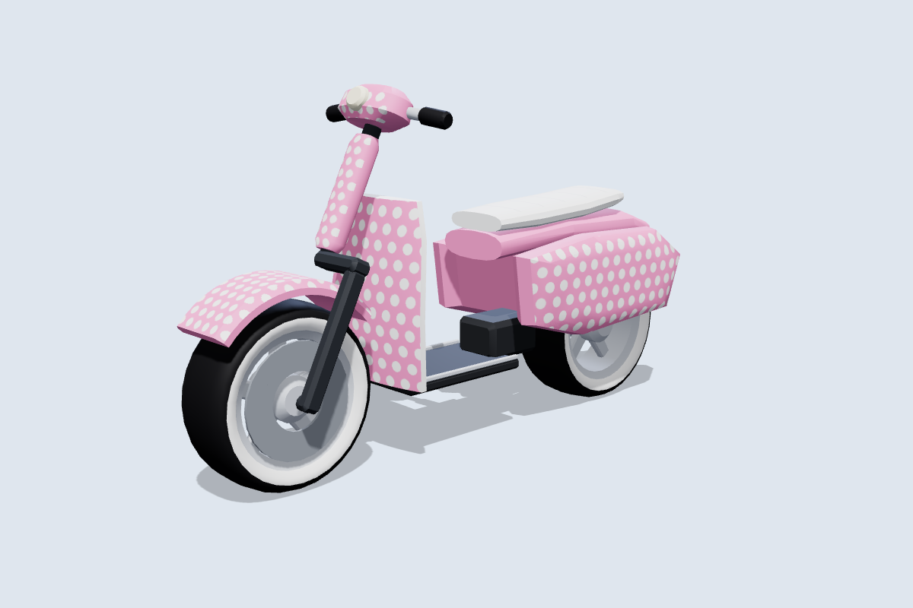
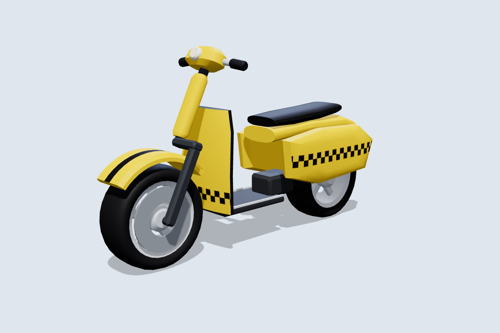
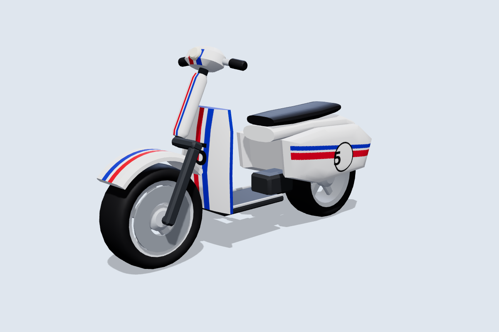
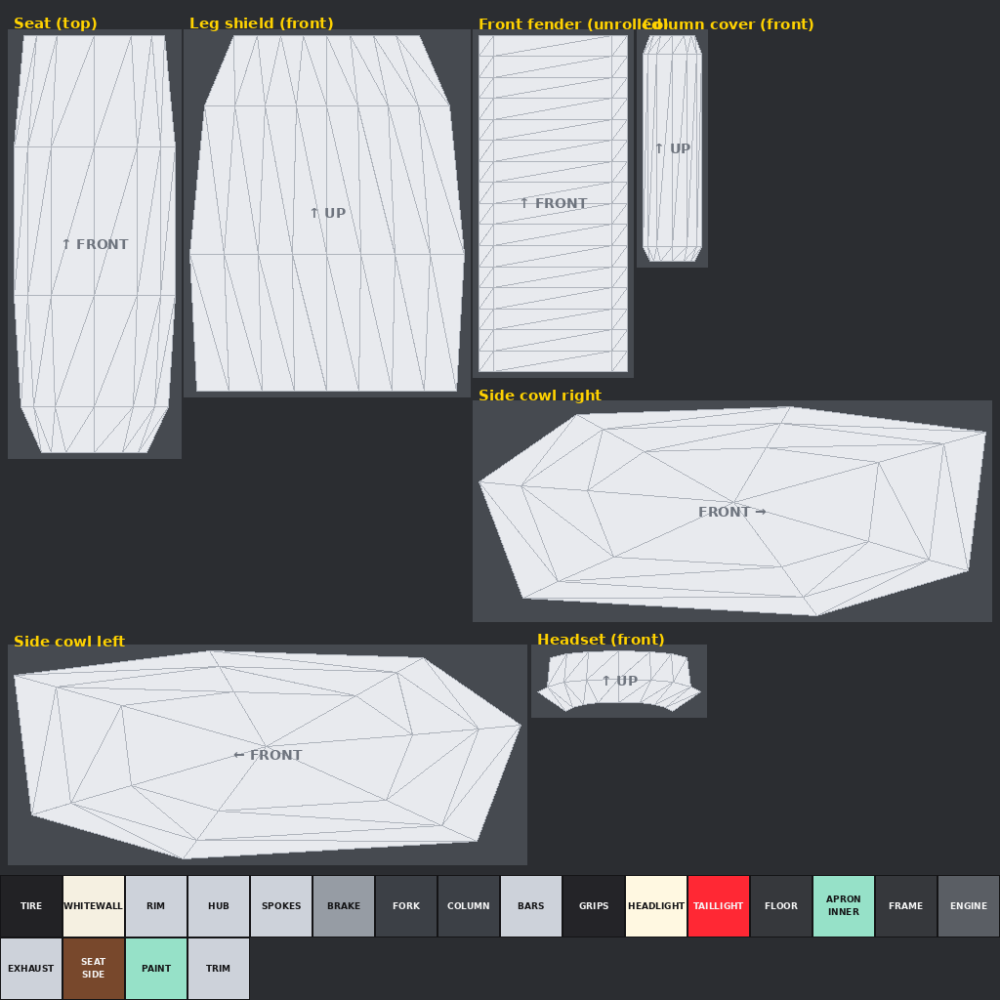

# Motorcycle Tag: scooter

The fifth bike: a retro step-through scooter with small whitewall wheels, a leg shield, a floorboard, rounded rear side cowls, a single-sided front fork and a headset with the headlight built in. It follows the same conventions as the [other bikes](../README.md) and is **built for skins**: one 1024×1024 texture per skin.

| Bubblegum | Taxi | Racer |
|---|---|---|
|  |  |  |

More angles, including steering at 30° and the wheels pulled out, are in [`previews/`](previews).

## How it differs from the other bikes

- **Steering:** the leg shield, floor and rear cowls are fixed to the body. The single-sided fork, the column cover, the front fender and the headset turn in front of the leg shield, like a real scooter.
- **Engine:** the engine unit on the right side is the `Swingarm` part, which lets the rig find the rear axle.
- **Size:** it's the smallest bike at 6.6 studs long, about 1.5 studs shorter than the others. Players get a smaller target, so treat it as a fun or joke pick, or give it slower stats to balance.

## Files

| File | What it is |
|---|---|
| `MotorcycleTag_Scooter.glb` | Main file for the Roblox 3D Importer or Blender, with the Mint skin embedded. |
| `MotorcycleTag_Scooter.obj` + `.mtl` | The same 12 parts as OBJ objects, using `skins/mint.png`. |
| `skin_template.png` / `uv_overlay.png` | The labelled texture layout, and a transparent wireframe to paint over. |
| `skins/*.png` | Example skins: `mint` (mint and cream), `bubblegum` (pink polka dots), `taxi` (yellow and checkers), `racer` (white with red and blue stripes, #5). |
| `source/build_scooter.py` | Generator for all of the above. It needs numpy and Pillow, and uses the shared `../source/skinkit.py`. |

## Making skins

| Panel | Notes |
|---|---|
| Side cowl right / left | The rounded rear body panels. These are the main graphics area. |
| Leg shield (front) | Seen from the front. Good for a number or logo. |
| Column cover (front), headset (front) | The parts that turn with the bars. |
| Front fender (unrolled), seat (top) | |

The blocks at the bottom are solid colours for everything else. `PAINT` colours panel edges and the tail, `APRON_INNER` the rider's side of the leg shield, `FLOOR` the floorboard, and `WHITEWALL` the lower tire sidewalls. Upload the PNG and apply it with `MotorcycleRig.SetSkin(bike, "rbxassetid://<id>")`.

## Specs

- **Size:** 6.6 L × 3.9 H × 1.9 W studs. The seat is at about 2.6 studs and the floorboard at 0.9 studs.
- **Axes:** +Y is up and the bike faces **−Z**. The steering axis runs through the front wheel centre, tilted back **26°**.
- **Budget:** 5,636 triangles across 12 meshes, with one texture.

| Group | Parts | Pivot |
|---|---|---|
| **Wheels** | `FrontWheel`, `RearWheel` (both Ø 1.9 × 0.72) | Each centred on its axle at (0, 0.95, −2.4) and (0, 0.95, 2.25). |
| **Steering** | `Fork`, `Handlebars` (the headset), `FrontFender`, `Headlight` | Front axle. |
| **Body** (welded) | `Frame`, `Bodywork`, `Seat`, `Swingarm`, `TailLight` | Model origin. `Frame` (the floorboard) is the root. |

`python3 source/build_scooter.py --check` sweeps the steering through ±30° and spins both wheels:

- Steering parts vs the body: at least 0.11 studs at any angle.
- Front tire vs fender: 0.10 studs.
- Rear tire vs the side cowls: 0.10 studs.
- Closest of all are the axle stubs, 0.05 to 0.06 studs from the hubs. They share the wheels' axis, so they don't collide.

## Importing and rigging

Import the same way as the other bikes: **Home → Import 3D**, scale unit **Stud**, keep the meshes as separate parts. `roblox/MotorcycleRig.lua` picks the 26° rake from the model name `MotorcycleTag_Scooter`. If you rename the model, give it a `SteeringRake` attribute of 26 or call `Rig(bike, { rake = 26 })`.
