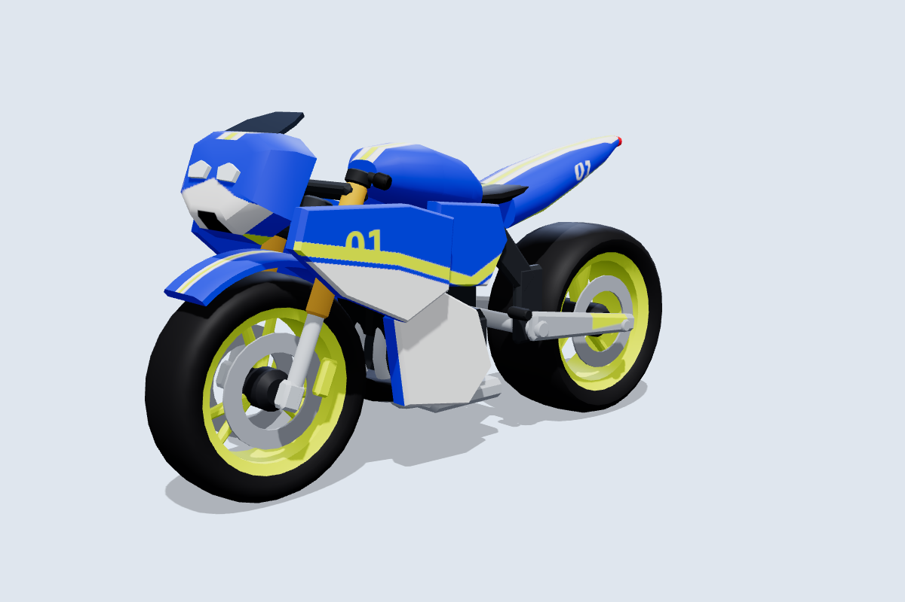
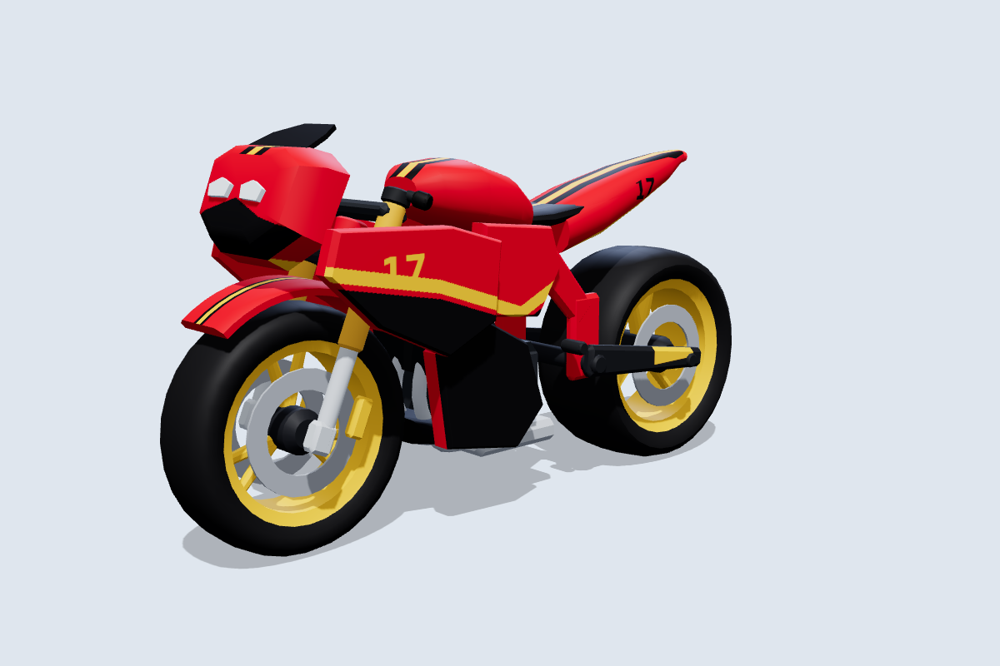
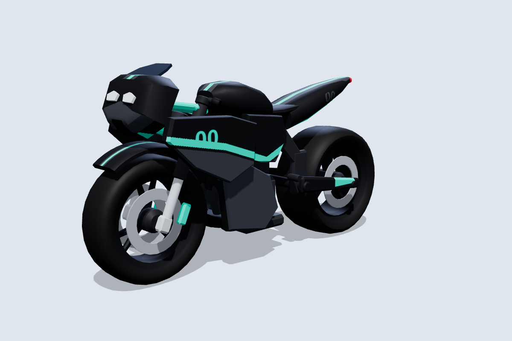
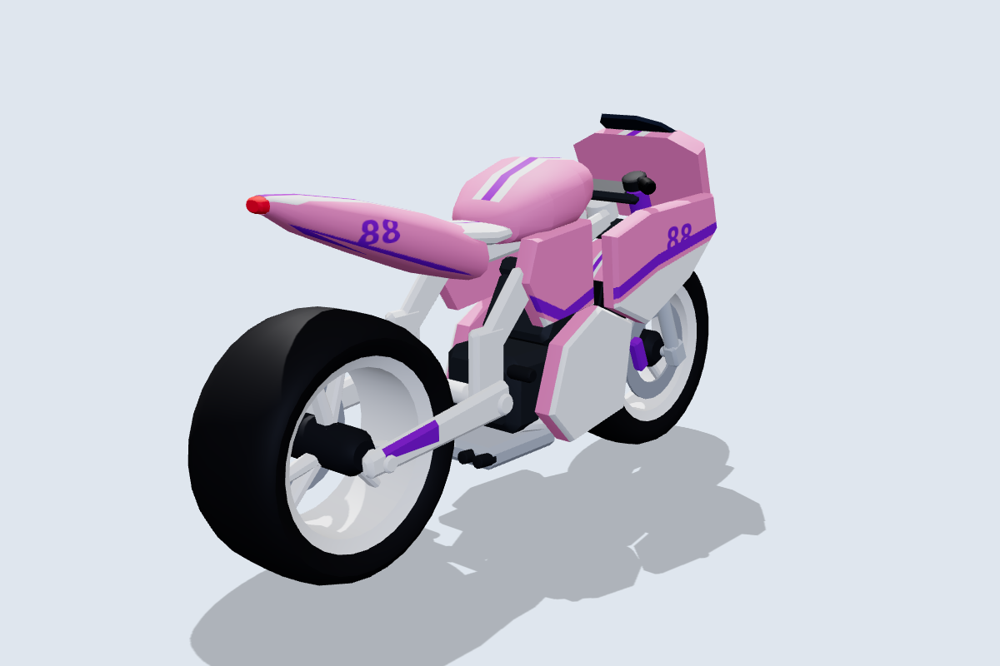
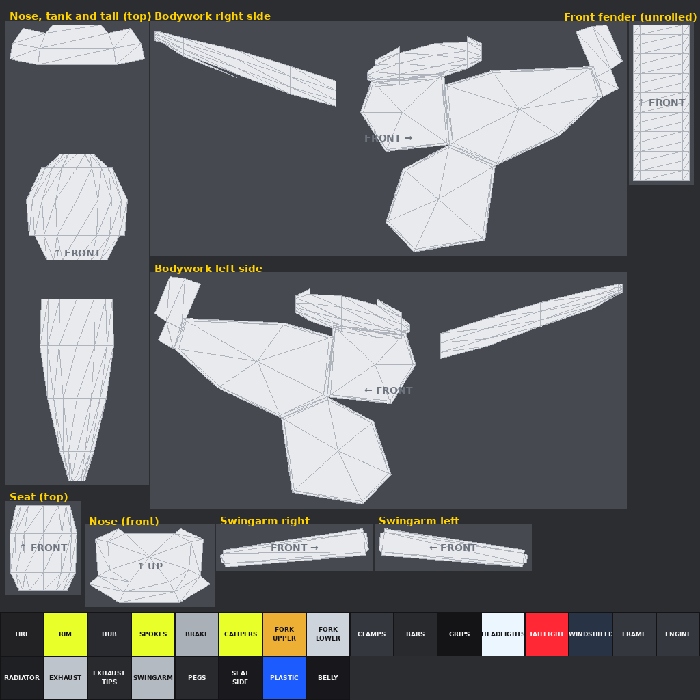

# Motorcycle Tag: superbike

The third bike: a full-fairing race bike with a wedge nose, twin headlights, clip-on bars, a fat rear tire and a sharp tail. It follows the same conventions as the [street bike](../README.md) and [dirt bike](../dirtbike/README.md): separate wheel meshes centred on their axles, shared part names, and the same rig script. Like the dirt bike, it is **built for skins**: one 1024×1024 texture per skin.

| Inferno | Phantom | Sakura |
|---|---|---|
|  |  |  |

More angles, including steering at 30° and the wheels pulled out, are in [`previews/`](previews).

## How it differs from the other bikes

As on a real superbike, the **fairing, headlights and windshield are fixed to the frame**. Only the fork, clip-on bars and front fender turn with the steering. They turn inside a gap left around the space the fork sweeps through. In Roblox the nose stays pointing straight while the front wheel turns under it.

## Files

| File | What it is |
|---|---|
| `MotorcycleTag_SuperBike.glb` | Main file for the Roblox 3D Importer or Blender, with the Apex skin embedded. |
| `MotorcycleTag_SuperBike.obj` + `.mtl` | The same 14 parts as OBJ objects, using `skins/apex.png`. |
| `skin_template.png` | The texture layout with every paintable area labelled. Start new skins from this. |
| `uv_overlay.png` | Transparent wireframe of the layout. Put it on a top layer while you paint and hide it before export. |
| `skins/*.png` | Skins: `apex`, `inferno`, `phantom`, `sakura`, `verde`, `solar`, `ice`, `obsidian`, `prism`. |
| `source/build_superbike.py` | Generator for all of the above. It needs numpy and Pillow, and uses the shared `../source/skinkit.py`. |

## Making skins

The texture works the same way as the dirt bike's. Panels at the top are laid out as you'd see them from outside the bike, so text reads correctly, and the blocks at the bottom are solid colours for the mechanical parts.

| Panel | Notes |
|---|---|
| Bodywork right / left side | The whole side view on one canvas: nose sides, upper fairing, mid panel, lower fairing, tank sides and tail. Paint the livery as one picture. |
| Nose, tank and tail (top) | Seen from above, with the front at the top. Racing stripes go down the middle. |
| Nose (front) | Seen from the front. The headlights cover the upper middle. |
| Seat (top), front fender (unrolled), swingarm right / left | Smaller detail areas. |

Fill the `PLASTIC` block with your main body colour; it colours the fairing edges, inner faces and undersides. Then follow the same workflow as the dirt bike: paint, export a 1024×1024 PNG, upload it, and apply it with `MotorcycleRig.SetSkin(bike, "rbxassetid://<id>")`.

## Specs

- **Size:** 8.1 L × 4.35 H × 2.1 W studs, close to the other bikes. The seat is at about 3.35 studs; the footpegs are high and set back at 1.8 studs.
- **Axes:** +Y is up and the bike faces **−Z**. The steering axis runs through the front wheel centre, tilted back **23°**.
- **Budget:** 8,580 triangles across 14 meshes, with one texture.

| Group | Parts | Pivot |
|---|---|---|
| **Wheels** | `FrontWheel` (Ø 2.6 × 0.84, twin discs), `RearWheel` (Ø 2.72 × 1.24) | Each centred on its axle at (0, 1.3, −2.75) and (0, 1.36, 2.65). |
| **Steering** | `Fork`, `Handlebars`, `FrontFender` | Front axle. |
| **Body** (welded) | `Frame`, `Bodywork`, `Headlights`, `Windshield`, `Seat`, `Engine`, `Exhaust`, `Swingarm`, `TailLight` | Model origin. `Frame` is the root. |

`python3 source/build_superbike.py --check` sweeps the steering through ±30° and spins both wheels:

- Steering parts vs the fixed fairing and body: at least 0.08 studs at any angle. The closest point is the clip-on grips passing under the fairing's top edge. The upper fork clamp sits 0.05 above the head tube, but they share the steering axis like a bearing, so that gap never changes.
- Front tire vs fender: 0.10 studs.
- Rear tire: at least 0.18 studs to the frame.
- Closest of all are the axle stubs and brake calipers, about 0.05 to 0.07 studs from the parts they hold. They share the wheel's axis, so they don't collide.

## Importing and rigging

Import the same way as the other bikes: **Home → Import 3D**, scale unit **Stud**, keep the meshes as separate parts. `roblox/MotorcycleRig.lua` picks the 23° rake from the model name `MotorcycleTag_SuperBike`. It welds `Headlights` and `Windshield` to the frame, and makes them Neon and Glass. If you rename the model, give it a `SteeringRake` attribute of 23 or call `Rig(bike, { rake = 23 })`.
