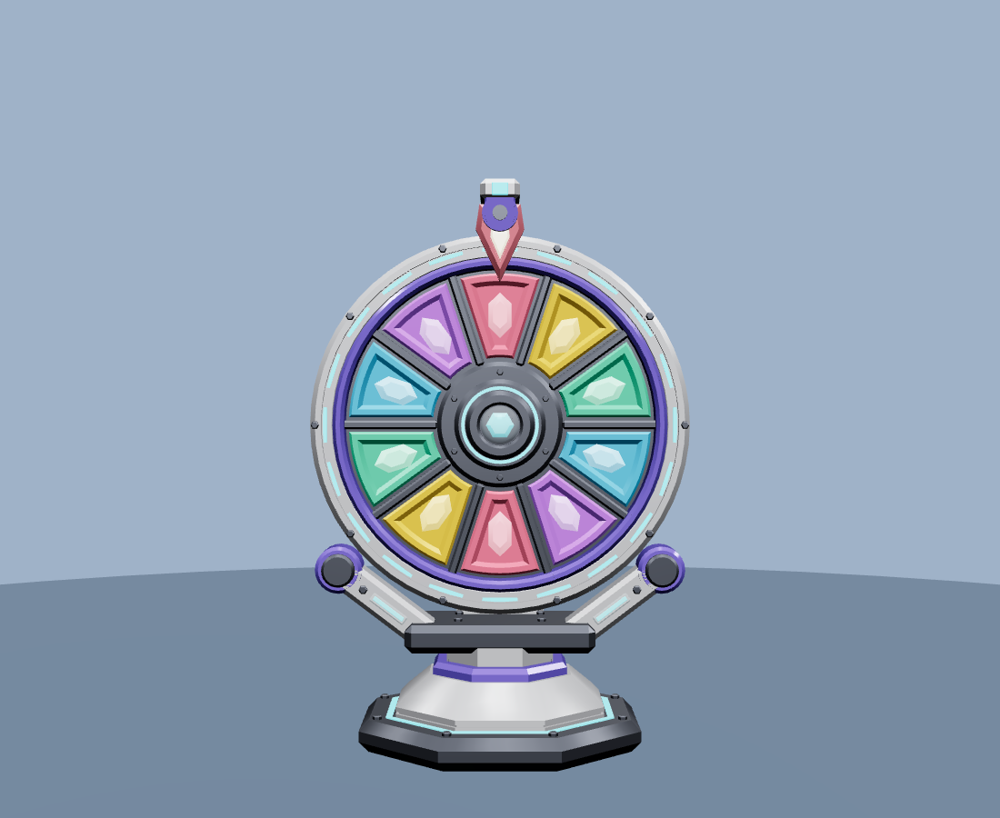
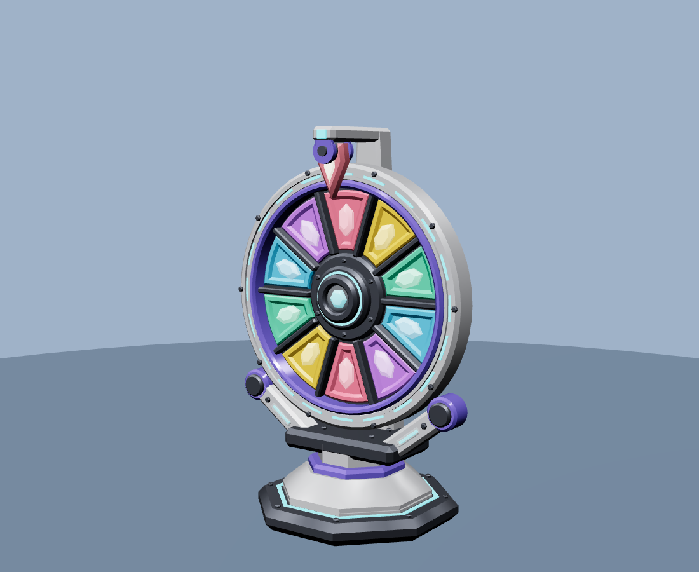

# Aurora Spin Core — Roblox prize wheel machine

Original, game-ready stylised 3D asset. Procedurally generated, so every proportion is a parameter at the top of `build_prize_wheel.py`.

 

## Files
| File | Purpose |
|---|---|
| `out/PrizeWheel.glb` | Full assembly: named nodes, PBR materials, pivots set. Import this. |
| `out/meshes/*.obj` | Each component alone, pivot at its local origin (fallback import / swap-ins). |
| `PrizeWheel_Setup.lua` | Run after import: Roblox Materials, colours, welds, `:Spin(i)` / `:Flick()`. |
| `build_prize_wheel.py` | Generator (`pip install trimesh scipy networkx`, then `python3 build_prize_wheel.py`). |

## Hierarchy and pivots
```
PrizeWheel
├─ Base      origin = ground, centred under the axle
│   Base_Body (pearl paint) · Base_Metal (gunmetal) · Base_Accent (gloss indigo) · Base_LED (neon) · Base_Glass (acrylic)
├─ Wheel     origin = hub centre, spins about local Z
│   Wheel_Frame · Wheel_Rim · Wheel_Accent · Wheel_LED · Hub_Glass · Hub_Core
│   Segment_01..10 + SegmentGem_01..10   (one mesh each: recolour / retexture individually)
└─ Pointer   origin = pivot pin, swings about local Z
    Pointer_Body · Pointer_Core · Pointer_Pivot
```
Segment 01 is centred at 12 o'clock at rest and numbering runs clockwise.

## Budget
~12.3k triangles total (largest single mesh: Wheel_Frame, 3.9k). 10 prize panels, 10-fold symmetry, 36 meshes.
Scale: wheel diameter ≈ 15 studs, overall height ≈ 22 studs (`SCALE` in the script).

## Design notes
- **Silhouette:** big wheel, low octagonal foot, saddle with two angled arms ending in guide rollers, rear spine carrying the pointer arm. Reads as a machine, not a flat disc.
- **Layering:** painted rim → LED channel → glossy bezel → recessed panels with emissive crystals → dark divider fins → bolted hub with glass dome.
- **Detail rule:** only details that change the silhouette or a light/shadow edge are real geometry (bevels, LED channel, bolts, rollers); no greebles.

## Caveats
Previewed in three.js, **not yet inside Roblox Studio**. Roblox's importer may not carry glTF PBR factors, which is why the Lua script re-applies material/colour by part name. If the wheel spins about the wrong axis after import, change `WHEEL_AXIS` in the script.
